# DH-02 — Sistema de Gestión de Mantenimiento y Órdenes de Trabajo del Campus
## Evaluación 2 — Arquitectura y Diseño

| Campo | Valor |
|---|---|
| Proyecto | DH-02 · Oficina de Instalaciones y Operaciones del Campus, Horizon University |
| Equipo consultor | María Fernanda Romero · Sebastián Brito · Samuel Ramos |
| Hito | Evaluación 2 — Architecture and Design Review |
| Versión del documento | `v1.0` · Fecha: `2026-10-11` · Repositorio: [github.com/sramoscor/dh02-horizon-university](https://github.com/sramoscor/dh02-horizon-university) · Commit revisado: sin código de PoC (el repositorio solo contiene la documentación y la estructura de carpetas) |
| Insumos | Evaluación 1 (visión y alcance, registros de stakeholders/aclaraciones/supuestos, requisitos, backlog, riesgos, criterios de éxito) |

> **Cómo leer este documento.** Todos los valores numéricos (umbrales, tiempos, plazos) son **metas propuestas**, no resultados medidos. Toda prueba figura como **NOT EXECUTED** hasta que exista evidencia real. Lo que está *diseñado* no está necesariamente *implementado*, y lo implementado no está necesariamente *verificado*. Las reglas marcadas como *suposición formal del equipo* (§2.4) fueron adoptadas por el equipo el 2026-10-11 y siguen pendientes de confirmación con el cliente.
>
> **Marcador `[PR - Pendiente por responder]`.** Indica un dato que el equipo todavía debe definir. La tabla siguiente muestra cómo quedó resuelto cada pendiente.

### Lista de pendientes (PR - Por responder)

| ID | Pendiente | Dónde aparece | Estado al 2026-10-11 |
|---|---|---|---|
| PR-01 | Tecnologías y versiones exactas | §5.2, §9.5 | **Resuelto.** Pila tecnológica y versiones definidas para la versión final (§5.2) |
| PR-02 | Código de la PoC ejecutable | §10.1, §10.4 | **Resuelto.** La PoC todavía no está implementada; `/poc/` solo contiene la estructura de carpetas |
| PR-03 | Resultado de pruebas ejecutadas | §10.3, §10.4 | **Resuelto.** Ninguna prueba ejecutada todavía; todas siguen en NOT EXECUTED |
| PR-04 | Marcado de estado de los módulos | §10.5 | **Resuelto.** Todos los módulos quedan como **Documentado** |
| PR-05 | Repositorio Git y estructura de directorios | Encabezado, §11.4 | **Resuelto.** Repositorio público [github.com/sramoscor/dh02-horizon-university](https://github.com/sramoscor/dh02-horizon-university) con la estructura `/docs/evaluation-2/` y `/poc/` |
| PR-06 | Organización de archivos del entregable | §11.4 | **Pendiente.** Decidir si se entrega un único `.md` consolidado o archivos separados para ADRs, vistas y pruebas |

**Pregunta central:** ¿podemos justificar cómo debe estructurarse el sistema? La cadena de argumentación es:

`Requisito → Escenario de calidad → Driver → ADR → Vista/Componente → Prueba/Evidencia`

---

## Contenido

1. [Propósito y alcance](#1-propósito-y-alcance)
2. [Requisitos, reglas de negocio y suposiciones](#2-requisitos-reglas-de-negocio-y-suposiciones)
3. [Escenarios de calidad y drivers](#3-escenarios-de-calidad-y-drivers)
4. [Alternativas y decisiones (ADRs)](#4-alternativas-y-decisiones-adrs)
5. [Vistas estructurales](#5-vistas-estructurales)
6. [Dominio, datos y estados](#6-dominio-datos-y-estados)
7. [Interacciones críticas y comportamiento ante fallos](#7-interacciones-críticas-y-comportamiento-ante-fallos)
8. [Interfaces y contratos](#8-interfaces-y-contratos)
9. [Seguridad, privacidad y despliegue](#9-seguridad-privacidad-y-despliegue)
10. [Validación y estado de la evidencia](#10-validación-y-estado-de-la-evidencia)
11. [Riesgos, backlog y plan](#11-riesgos-backlog-y-plan)
12. [Trazabilidad, glosario y referencias](#12-trazabilidad-glosario-y-referencias)

---

# 1. Propósito y alcance

## 1.1 Problema

Los reportes de mantenimiento llegan por más de seis canales (correo, teléfono, mensajería, papel, contacto directo) y se coordinan con hojas de cálculo y notas personales. No existe una fuente única de verdad: los reportes se duplican, la urgencia se evalúa de forma inconsistente, las asignaciones son informales, los trabajos se marcan como completados sin confirmación y no hay historial confiable de quién decidió qué ni por qué se retrasó algo.

**Resultado buscado:** un ciclo de vida único y controlado desde el reporte hasta el cierre, un registro autoritativo de las órdenes de trabajo y un historial defendible de decisiones. No se busca solamente "un formulario más bonito".

## 1.2 Capas de alcance

| Capa | Contenido |
|---|---|
| **Diseño del producto** | Solicitudes, triaje (validar, clasificar, redirigir, vincular duplicados), órdenes de trabajo, asignación y reasignación, bloqueos, materiales y observaciones, confirmación y reapertura, escalamiento de atrasos, notificaciones, auditoría, búsqueda y tablero operativo, integraciones simuladas. |
| **Prueba de concepto (PoC) propuesta** | Un flujo completo (solicitud → triaje → orden → asignación → bloqueo → finalización → confirmación → cierre) con auditoría, más: carrera de dos coordinadores, caída de notificaciones con reintento y un intento no autorizado. |
| **Cobertura de diseño de apoyo** | Reglas de urgencia configurables, detección de atrasos, bandera de seguridad, cierre administrativo. |
| **Fuera de alcance** | Control de equipos o IoT, sistemas financieros/compras/pagos/nómina, reemplazo de la Mesa de Ayuda de TI, rastreo de dispositivos, GIS completo, registro empresarial de activos, conexión a sistemas reales de seguridad, datos reales, proyectos de construcción, predicción de fallas con ML (según RFP DH-02 §10). |

**Decisión de diseño del caso:** una orden de trabajo tiene una ubicación primaria. Las órdenes con varias visitas o técnicos se modelan con *visitas* y *asignaciones* dentro de la misma orden (ASM-004), no como órdenes separadas.

## 1.3 Stakeholders → preocupaciones → consecuencias de diseño

| Stakeholder | Preocupación principal | Consecuencia de diseño |
|---|---|---|
| Solicitante | Saber si su reporte está siendo atendido | Estados visibles y separados (solicitud / orden / notificación) |
| Coordinador de Instalaciones | Reportes ambiguos y duplicados | Triaje obligatorio, detección de duplicados, validación en servidor |
| Técnico | Asignaciones claras, con materiales y accesos | Vista "mis órdenes", bloqueos con motivo tipificado |
| Supervisor | Visibilidad de carga y atrasos | Consultas de carga, detección de atrasos, reasignación auditada |
| Representante de edificio | Coordinar acceso y confirmar resultado | Permiso acotado a su edificio; confirmación como paso explícito |
| Contratista externo | Alcance claro, acceso limitado | Sin acceso completo; registro por coordinador/supervisor (CL-010) |
| Director de Instalaciones | Reportes confiables, baja adopción como riesgo | Reportes acotados, flujo simple de usar |
| Servicios de TI | Mantenibilidad, autenticación, integraciones auditables | Adaptadores, autorización por recurso, despliegue simple |

---

# 2. Requisitos, reglas de negocio y suposiciones

## 2.1 Glosario congelado

Estos términos significan lo mismo en todos los artefactos (riesgo R-005: confundir *solicitud* con *orden*).

| Término | Significado |
|---|---|
| **Solicitud de mantenimiento** (`MaintenanceRequest`) | Reporte inicial del usuario. Es su "voz" y no compromete recursos técnicos. |
| **Registro de triaje** (`TriageRecord`) | Decisión del coordinador sobre una solicitud: aprobar y crear orden, rechazar, redirigir, vincular a una orden existente o pedir más información. Guarda categoría, urgencia validada y motivo. |
| **Orden de trabajo** (`WorkOrder`) | Compromiso operativo para ejecutar una reparación. Solo nace de un triaje aprobado. |
| **Asignación** (`Assignment`) | Relación activa entre una orden y un técnico (o contratista registrado). Puede cambiar; el historial se conserva. |
| **Visita** (`Visit`) | Intervención programada o realizada en sitio. Una orden puede tener varias. |
| **Evento de bloqueo** (`BlockEvent`) | Periodo en que la orden no puede avanzar, con motivo tipificado (materiales, acceso, contratista, aprobación). |
| **Confirmación** (`CompletionConfirmation`) | Aceptación del resultado por el solicitante o el representante del edificio; o cierre administrativo automático del sistema tras el plazo (E2-AS-02). |
| **Versión de política** (`PolicyVersion`) | Conjunto versionado de reglas (urgencia, plazos, categorías) usado para evaluar una solicitud u orden. |
| **Directorio de espacios** (`Space Directory`) | Fuente autoritativa y externa de edificios y salas (simulada). DH-02 guarda solo una *proyección* local. |
| **Auditoría** (`AuditEvent`) | Registro de una mutación de negocio aceptada. Distinto de logs operativos. |
| **Outbox** (`OutboxEvent`) | Intención de notificación persistida en la misma transacción que la mutación de negocio. |

**Solicitud aprobada ≠ trabajo ejecutado. Orden cerrada ≠ notificación entregada.**

## 2.2 Requisitos significativos

Las historias de usuario de la Evaluación 1 (US-001 a US-023) siguen vigentes. Esta tabla resume los requisitos que condicionan la arquitectura.

| ID | Requisito en el diseño | Historias | Significancia arquitectónica |
|---|---|---|---|
| E2-FR-01 | Un solicitante autenticado crea, envía y consulta sus solicitudes, con ubicación validada contra el directorio | US-001/002/003/023 | Propiedad, autorización en servidor, proyección del directorio |
| E2-FR-02 | El coordinador realiza el triaje: validar, clasificar categoría/urgencia, redirigir, rechazar, pedir información o vincular duplicados | US-005/006/007/008 | Modelo de transiciones, detección de duplicados, política de urgencia |
| E2-FR-03 | La aprobación crea una única orden de trabajo, de forma atómica | US-009 | Límite transaccional, unicidad |
| E2-FR-04 | Asignar, reasignar y escalar técnicos con historial | US-014/015/016 | Política de asignación, auditoría |
| E2-FR-05 | El técnico registra inicio, bloqueos con motivo, materiales y observaciones | US-010/011 | Estados, eventos de bloqueo |
| E2-FR-06 | Confirmar, reabrir o cerrar administrativamente | US-012/013 | Autorización por relación, plazos |
| E2-FR-07 | Detectar órdenes urgentes o atrasadas y alertar al supervisor | US-018 | Job programado en el worker |
| E2-FR-08 | Notificar cambios relevantes sin que su falla afecte la orden | US-004/017 | Outbox, worker |
| E2-FR-09 | Registrar todo cambio de estado, asignación y decisión | US-019 | Auditoría en la misma transacción |
| E2-FR-10 | Tablero, búsqueda/filtrado y reportes de recurrencia por ubicación/categoría | US-020/021 | Consultas acotadas, lecturas autorizadas |
| E2-FR-11 | Autenticación institucional simulada y control de acceso por rol y relación con la orden | US-022 | Adaptador de identidad, autorización por recurso |

## 2.3 Reglas de negocio e invariantes

| ID | Regla |
|---|---|
| BR-01 | Una solicitud no compromete recursos. Solo una orden creada en triaje lo hace (CL-002). |
| BR-02 | Cada solicitud produce **como máximo una** orden de trabajo. |
| BR-03 | No pueden coexistir silenciosamente dos órdenes **activas** para la misma ubicación y categoría. Si el coordinador determina que son problemas distintos, debe declararlo explícitamente (ver ADR-003). |
| BR-04 | El solicitante *sugiere* la urgencia; el coordinador la *decide*. Se conservan ambas (CL-003). |
| BR-05 | Un caso con bandera de seguridad fuerza urgencia máxima y notificación inmediata *(suposición formal del equipo, CL-012)*. |
| BR-06 | Bloquear una orden exige un motivo tipificado y notifica al supervisor (CL-009). |
| BR-07 | El cierre exige confirmación del solicitante o del representante de edificio, o cierre administrativo automático del sistema tras 7 días hábiles sin respuesta *(suposición formal del equipo, CL-006)*. |
| BR-08 | Toda mutación de negocio aceptada genera un evento de auditoría. Ningún historial se borra. |
| BR-09 | Una falla de notificación jamás revierte ni bloquea una mutación de negocio (ASM-006). |
| BR-10 | La autorización se verifica en el servidor para toda operación protegida; se deniega por defecto. Nadie triagea ni confirma su propia solicitud. |
| BR-11 | El supervisor puede reasignar una orden en cualquier estado activo (ASM-010). |
| BR-12 | Rechazar o redirigir una solicitud exige registrar el motivo (CL-005). |
| BR-13 | Los contratistas externos no tienen acceso completo: su trabajo lo registra el coordinador o el supervisor (CL-010). |

## 2.4 Suposiciones y decisiones abiertas

> **Estado de cada fila: suposición formal adoptada por el equipo el 2026-10-11; no confirmada por el cliente.** Cada una declara su consecuencia de diseño (tabla siguiente) y se lleva como pregunta a la próxima consulta.

| ID | Suposición (regla provisional) | Origen | Validar con |
|---|---|---|---|
| E2-AS-01 | **Regla de asignación** (CL-004): se filtra por especialidad y disponibilidad activa y se ordena automáticamente por menor número de órdenes activas; el coordinador o supervisor puede imponer otra con motivo. Se implementa como política intercambiable. | CL-004 | Supervisor |
| E2-AS-02 | **Cierre administrativo** (CL-006): si el solicitante o el representante del edificio no responde en 7 días hábiles tras `PENDING_CONFIRMATION`, el sistema ejecuta un cierre administrativo automático (`ADMIN_CLOSED`) registrado en la auditoría. | CL-006 | Representante de edificio / Supervisor |
| E2-AS-03 | **Bandera de seguridad** (CL-012): todo reporte con riesgo de seguridad (p. ej. fugas, fallas eléctricas críticas) fuerza de inmediato la urgencia máxima y envía una alerta instantánea al supervisor y al coordinador; solo el supervisor puede degradar esa prioridad, tras la inspección. | CL-012 | Supervisor / Universidad |
| E2-AS-04 | **Plazos por urgencia y pausa del SLA** (valores propuestos): máxima 4 h, alta 24 h, media 72 h, baja 7 días. El reloj **se pausa** mientras la orden esté en `BLOCKED` por `MATERIALS` o `ACCESS` y se reanuda al volver a `IN_PROGRESS`. | RFP §5, SC-06 | Supervisor / Director |
| E2-AS-05 | El directorio de espacios es autoritativo para ubicaciones. Una proyección de hasta 24 h de antigüedad es aceptable para recibir y triagear solicitudes. | ASM-002, CL-008 | Servicios de TI |
| E2-AS-06 | DH-02 es el único escritor de órdenes de trabajo del dominio simulado. | RFP | Servicios de TI |
| E2-AS-07 | Un coordinador que también es solicitante no puede triagear su propia solicitud (separación de funciones). | BR-10 | Director |
| E2-AS-08 | Las referencias a fotos o documentos son simuladas; solo se guardan metadatos. | ASM-008 | Responsable de privacidad |
| E2-AS-09 | Las fechas se guardan en UTC y se muestran en la zona horaria configurada del campus. | Diseño | Servicios de TI |

**Consecuencias de diseño de E2-AS-01 a E2-AS-04**

| Suposición | Consecuencia en el diseño |
|---|---|
| E2-AS-01 | La asignación es una `AssignmentPolicy` intercambiable (ADR-005). La carga se cuenta como órdenes activas (no terminales) por técnico. Una asignación impuesta exige motivo y queda en auditoría. Si ningún técnico cumple el filtro, la orden queda sin asignar y visible al supervisor. |
| E2-AS-02 | El worker revisa periódicamente las órdenes en `PENDING_CONFIRMATION` y, vencido el plazo (días hábiles según el calendario configurado del campus), ejecuta la transición a `ADMIN_CLOSED` con actor de sistema, auditoría y outbox al solicitante. La confirmación humana prevalece si llega antes. El cierre administrativo no impide la reapertura (`ADMIN_CLOSED` se trata como cierre reabrible). Cambia la tabla de transiciones (§6.6), el comando de cierre (§8.1) y agrega una prueba de plazo (T-SLA-01). |
| E2-AS-03 | La bandera se evalúa en el mismo triaje que fija la urgencia: urgencia máxima y evento de alerta se confirman en la misma transacción (QS-08). Degradar la urgencia es un comando exclusivo del supervisor, con motivo y auditoría. |
| E2-AS-04 | Cada `BlockEvent` de tipo `MATERIALS` o `ACCESS` pausa el SLA: al cerrarse, `due_at` se desplaza por la duración del bloqueo. Mientras la orden esté pausada, el scheduler no la considera atrasada. Los bloqueos de tipo `CONTRACTOR` y `APPROVAL` no están definidos por el equipo; hasta decidirlo, el reloj sigue corriendo en ellos. |

## 2.5 Escenario sintético de referencia

Se usa en todo el documento. Todos los datos son ficticios.

| Elemento | Valor |
|---|---|
| Solicitud A | `SR-2041` · reportada por `usr-017` (estudiante) · "Fuga en tubería del laboratorio" · sala `L-204`, edificio `CIE` · urgencia sugerida: MEDIA |
| Solicitud B (posible duplicado) | `SR-2042` · reportada por `usr-052` (profesor) · misma sala y categoría |
| Triaje | Coordinador `coord-03` valida categoría `PLUMBING`, urgencia ALTA |
| Orden | `WO-3001` · técnico `TECH-014` (especialidad plomería) |
| Acceso | Laboratorio restringido → representante `rep-CIE-01` coordina acceso y confirma |
| Bloqueo ejemplo | `BLOCKED` por `MATERIALS` (falta una válvula) |
| Directorio | `DIR-v118` (versión opaca de la proyección) |

---

# 3. Escenarios de calidad y drivers

Cada escenario usa la forma de seis partes. Los valores son **metas propuestas**; ninguno ha sido medido.

## 3.1 Escenarios críticos

### QS-01 · Unicidad de la orden bajo concurrencia

| Campo | Valor |
|---|---|
| Fuente | Dos coordinadores distintos |
| Estímulo | Aprueban a la vez `SR-2041` y `SR-2042` (misma sala, misma categoría, sin discriminador) con la acción `APPROVE_CREATE_WO` |
| Entorno | Operación normal; base de datos sana; proyección del directorio vigente; ambas solicitudes en `UNDER_TRIAGE` |
| Artefacto | `TriageApplicationService` y el índice único parcial sobre órdenes activas |
| Respuesta | Se confirma una sola orden. La otra operación se revierte por completo y responde un conflicto de negocio que referencia la orden existente, para que el coordinador pueda vincularla |
| Medida | En cada uno de 100 ensayos aislados: exactamente 1 éxito y 1 conflicto; 0 pares de órdenes activas con la misma (ubicación, categoría, discriminador); 1 conjunto de auditoría y outbox solo para la operación ganadora. Además, dos aprobaciones simultáneas de la **misma** solicitud crean una sola orden |

### QS-02 · Falla de notificaciones tras una mutación

| Campo | Valor |
|---|---|
| Fuente | Servicio de notificaciones simulado o inyector de fallos |
| Estímulo | El servicio no responde durante 2 minutos después de asignar un técnico |
| Entorno | Base de datos sana; worker operativo; una asignación reciente; sin intentos agotados |
| Artefacto | `OutboxEvent`, worker con *lease* y reintentos, adaptador de notificaciones |
| Respuesta | La orden permanece en `ASSIGNED`. La entrega queda pendiente y se reintenta con la misma clave de entrega |
| Medida | 0 órdenes perdidas o revertidas; el evento persiste durante la caída; entrega completada en ≤ 60 s tras restaurar el servicio; sin notificaciones duplicadas efectivas con receptor que deduplica |

Parámetros de ejemplo: sondeo ≤ 2 s; *timeout* de petición 5 s; esperas de 5, 10, 20 y luego 30 s; máximo 12 intentos; *lease* de 15 s. Una caída más larga puede llegar a `DEAD_LETTER` y requerir intervención.

### QS-03 · Auditoría reconstruible

| Campo | Valor |
|---|---|
| Fuente | Supervisor o director investigando un retraso |
| Estímulo | Consultar el historial tras triaje, asignación, bloqueo, reasignación, finalización, confirmación y reapertura |
| Entorno | Flujo sintético con actores y estados conocidos |
| Artefacto | `AuditEvent`, consulta de historial autorizada |
| Respuesta | Reconstruir autor, rol, momento, estado anterior y posterior, motivo y correlación de cada mutación aceptada |
| Medida | 100 % de las mutaciones probadas tienen su registro; una operación revertida no deja registro de éxito; el orden es reconstruible; el acceso no autorizado se deniega |

La auditoría es de solo anexado para los roles de la aplicación. No protege contra un superusuario de la base de datos (riesgo residual R-014).

### QS-04 · Denegación de acciones no autorizadas

| Campo | Valor |
|---|---|
| Fuente | Usuario sin sesión, solicitante sobre una orden ajena, técnico sobre una orden no asignada, coordinador sobre su propia solicitud |
| Estímulo | Leer detalles protegidos, hacer triaje, cerrar, reasignar o consultar notas internas sin permiso |
| Entorno | API invocada directamente (sin pasar por la interfaz); fixtures de rol, alcance, propiedad y estado |
| Artefacto | Validación de sesión, `AuthorizationService`, guardas de comandos, filtrado de consultas |
| Respuesta | Denegar, no revelar campos protegidos y no modificar el estado |
| Medida | 100 % de los casos de la matriz negativa denegados; 0 escrituras de negocio; sin auditoría ni outbox de éxito; la matriz incluye un control positivo legítimo |

## 3.2 Escenarios de apoyo

| ID | Calidad | Estímulo | Respuesta | Medida propuesta |
|---|---|---|---|---|
| QS-05 | Modificabilidad | Nueva versión de política (`POL-002`) cambia el plazo de la categoría eléctrica al inicio de exámenes | Las nuevas solicitudes usan `POL-002`; las órdenes en curso conservan su versión | Resultado distinto entre versiones; sin cambios en el evaluador ni en el esquema. No se promete recarga en caliente |
| QS-06 | Confiabilidad / Escalamiento | Una orden no terminal supera su plazo | El worker la marca como atrasada, audita y alerta al supervisor una sola vez por umbral | Detección ≤ 5 min tras vencer el plazo (revisión cada 60 s) en el 100 % de los casos de prueba; sin alertas duplicadas |
| QS-07 | Desempeño en pico | 100 solicitudes de 100 usuarios sintéticos en 10 minutos (tormenta) | Todas se aceptan y persisten | 0 pérdidas; p95 del servidor < 1 s en `POST` de solicitud, en el entorno declarado (p. ej. 2 vCPU, 4 GiB). No es una previsión de capacidad productiva |
| QS-08 | Seguridad operativa | Solicitud con bandera de seguridad llega a triaje | Urgencia forzada al máximo y evento de alerta confirmado en la **misma** transacción | Evento persistido atómicamente con el triaje; entrega ≤ 60 s con worker sano. *(Regla provisional, CL-012)* |
| QS-09 | Interoperabilidad | El directorio devuelve datos inválidos, obsoletos o no responde | Se rechazan datos inválidos; si hay proyección vigente (≤ 24 h) se opera marcándola; sin proyección, se falla de forma segura | 0 proyecciones degradadas; todo caso inválido rechazado; la caída no pierde solicitudes ya aceptadas |

Una instancia de demostración no demuestra alta disponibilidad, capacidad productiva ni integración real con sistemas de la universidad.

## 3.3 Drivers de arquitectura

Un driver explica una consecuencia de diseño; no es un requisito copiado del backlog.

| Driver | Evidencia | Consecuencia |
|---|---|---|
| **AD-01** Integridad del ciclo de vida | BR-02/03; QS-01; CL-002, CL-007 | Separar solicitud y orden; unicidad garantizada por la base de datos; transacción de triaje |
| **AD-02** Trazabilidad | BR-08; QS-03; US-019 | Auditoría en la misma transacción que la mutación; modelo de transiciones explícito |
| **AD-03** Reglas cambiantes | BR-04/05; QS-05; R-001; CL-004/012 | Políticas versionadas e intercambiables (urgencia, plazos, asignación) |
| **AD-04** Integraciones desacopladas | BR-09; QS-02/09; ASM-006 | Outbox, worker, adaptadores con simulaciones |
| **AD-05** Acceso por rol y relación | BR-10/13; QS-04 | Identidad separada de autorización; permisos por recurso |
| **AD-06** Operación por un equipo pequeño | Restricción del RFP; semestre | Pocas piezas en ejecución; entorno reproducible; sin servicios distribuidos |
| **AD-07** Visibilidad operativa | BR-06; QS-06/07; SC-06/07 | Detección de atrasos en el worker; consultas acotadas |

## 3.4 Tensiones y costos aceptados

| Tensión | Resolución | Costo aceptado |
|---|---|---|
| Integración inmediata vs. registro confiable | Confirmar localmente y notificar de forma asíncrona | La notificación puede llegar con retraso |
| Alta disponibilidad vs. simplicidad | Un despliegue simple con una base de datos | Una falla del servidor interrumpe el servicio |
| Reglas flexibles vs. facilidad de implementación | Vocabulario pequeño de reglas validadas, no scripts arbitrarios | Flujos muy distintos requerirían rediseño |
| Prevenir duplicados vs. permitir fallas distintas en el mismo lugar | Índice único con discriminador explícito declarado por el coordinador | Un paso extra cuando hay dos fallas legítimas |
| Historial rico vs. datos mínimos expuestos | Guardar cambios de negocio; acotar quién los ve | Detalles de depuración van en logs operativos |
| Diseño completo vs. factibilidad del semestre | Probar el corte crítico y documentar lo restante | No todo se implementa en esta entrega |

---

# 4. Alternativas y decisiones (ADRs)

## 4.1 Alternativas de estructura

| Alternativa | Ajuste a DH-02 | Costo o riesgo | Conclusión |
|---|---|---|---|
| **A.** Aplicación única con poca modularidad | Despliegue simple | Mezcla interfaz, reglas y datos; erosiona la auditabilidad | Se descarta la falta de modularidad, no el despliegue único |
| **B.** Monolito modular con worker | Transacciones locales, fronteras de negocio claras, un solo despliegue | Requiere disciplina para mantener los límites | **Seleccionada** |
| **C.** Microservicios independientes | Útil con equipos y escalas independientes | Consistencia distribuida, orquestación, observabilidad; inviable de probar en un semestre | Sin necesidad demostrada que justifique el costo |
| **D.** Funciones/serverless | Encaja con tareas aisladas | Fragmenta el flujo central y complica las transacciones | No para el núcleo; reconsiderar tareas asíncronas puntuales |

Es un análisis cualitativo de ajuste, no un benchmark. Otro proyecto podría justificar otra estructura.

## 4.2 Registro de decisiones

| ID | Decisión | Drivers |
|---|---|---|
| E2-ADR-001 | Solicitud y orden como entidades separadas, con triaje obligatorio | AD-01, AD-02 |
| E2-ADR-002 | Monolito modular con worker de integración | AD-04, AD-06 |
| E2-ADR-003 | Integridad relacional: unicidad por solicitud y por (ubicación, categoría, discriminador) activas | AD-01 |
| E2-ADR-004 | Outbox transaccional para notificaciones | AD-04 |
| E2-ADR-005 | Políticas versionadas con patrón Strategy | AD-03 |
| E2-ADR-006 | Identidad separada de autorización por recurso | AD-05 |
| E2-ADR-007 | Modelo de transiciones explícito con auditoría en la misma transacción | AD-02, AD-01 |
| E2-ADR-008 | Adaptadores y simulaciones para identidad y directorio | AD-04, AD-06 |

Todas están en estado **seleccionada para este diseño**.

| ID | Autor | Fecha |
|---|---|---|
| E2-ADR-001 | María Fernanda | 2026-10-11 |
| E2-ADR-002 | Sebastián | 2026-10-11 |
| E2-ADR-003 | Samuel | 2026-10-11 |
| E2-ADR-004 | Sebastián | 2026-10-11 |
| E2-ADR-005 | María Fernanda | 2026-10-11 |
| E2-ADR-006 | Samuel | 2026-10-11 |
| E2-ADR-007 | María Fernanda | 2026-10-11 |
| E2-ADR-008 | Samuel | 2026-10-11 |

### E2-ADR-001 — Separar la solicitud de la orden de trabajo

- **Contexto.** El descubrimiento mostró que muchos reportes son falsas alarmas, están incompletos, son duplicados o competen a otra unidad (CL-002, CL-005).
- **Decisión.** Modelar `MaintenanceRequest` y `WorkOrder` como entidades distintas, unidas por un `TriageRecord`. Una orden solo se crea mediante un triaje aprobado.
- **Alternativas.** Crear una orden por cada reporte; una sola entidad con un campo de estado "aprobado".
- **Consecuencias.** Se evita crear trabajo por reportes inválidos y el historial de decisiones queda explícito. Cuesta un paso obligatorio del coordinador y más tablas.
- **Verificación.** T-FUN-01, T-CON-02.
- **Reconsiderar si.** El cliente decide que cierta categoría puede generar órdenes automáticamente.

### E2-ADR-002 — Monolito modular con worker

- **Contexto.** Equipo pequeño, un semestre, fuerte necesidad de integridad transaccional y operación simple.
- **Decisión.** Un código base modular, una base de datos relacional y un proceso *worker* de la misma versión. Módulos: Identidad y Acceso, Solicitudes, Triaje, Órdenes de Trabajo, Asignación, Políticas, Auditoría, Notificaciones, Reportes, Integraciones.
- **Alternativas.** Microservicios; funciones por caso de uso; aplicación sin módulos.
- **Consecuencias.** Transacciones locales y pruebas de integración sencillas. No hay despliegue ni escalado independiente por módulo, y los límites pueden erosionarse sin revisión y pruebas.
- **Verificación.** T-ARCH-01 (dependencias prohibidas), T-ENV-01.
- **Reconsiderar si.** Mediciones reales o equipos independientes justifican extraer un servicio.

### E2-ADR-003 — Integridad relacional de órdenes activas

- **Contexto.** Una consulta de duplicados puede ser correcta al ejecutarse y quedar obsoleta antes de insertar. Dos coordinadores pueden actuar a la vez. Una restricción dura sobre (ubicación, categoría) bloquearía fallas legítimamente distintas en la misma sala.
- **Decisión.**
  1. `UNIQUE(work_order.request_id)`: una solicitud, una orden.
  2. Índice único **parcial** sobre `(location_id, category_id, discriminator)` para órdenes en estados activos. El `discriminator` es vacío por defecto. Si el coordinador determina que se trata de un problema distinto, lo declara explícitamente con un valor propio.
  3. La detección de candidatos a duplicado en el triaje es **asesoría** para el coordinador. La garantía final la da la base de datos.
  4. Se traducen las violaciones de restricción a un error de negocio (`DUPLICATE_CANDIDATE_EXISTS`), nunca a un error técnico.
- **Alternativas.** Solo verificación en la aplicación (vulnerable a carreras); restricción sin discriminador (impide casos legítimos); bloqueo en memoria del proceso (no funciona con varias instancias); aislamiento serializable con reintentos.
- **Consecuencias.** La base protege entre procesos. La orden desnormaliza ubicación y categoría. Requiere pruebas con conexiones independientes.
- **Verificación.** T-CON-01, T-CON-02, T-TXN-01.
- **Reconsiderar si.** El cliente define una noción más rica de "mismo problema" (por ejemplo, por activo o por tiempo).

> Nota: un `UNIQUE` parcial es el mecanismo adecuado para igualdad. Las *exclusion constraints* de PostgreSQL se reservan para rangos (por ejemplo, intervalos de tiempo).

### E2-ADR-004 — Outbox transaccional

- **Contexto.** Escribir la orden y luego llamar al servicio externo deja una brecha de falla. Llamarlo antes de confirmar deja la brecha contraria (ASM-006, BR-09).
- **Decisión.** Insertar el evento y sus entregas en la misma transacción que la mutación. Un worker reclama trabajo con *lease*, envía por el adaptador y registra el resultado. No hay un servidor de mensajería adicional.
- **Alternativas.** Llamada síncrona; cola en memoria; escribir en la base y en un broker por separado; broker con relé.
- **Consecuencias.** Atomicidad local entre mutación e intención. La entrega es *al menos una vez*; la deduplicación depende de una clave estable y del receptor. Es un contrato explícito, no "exactamente una vez".
- **Verificación.** T-INT-01, T-INT-02, T-REC-01.
- **Reconsiderar si.** El volumen o los consumidores independientes justifican un broker.

### E2-ADR-005 — Políticas versionadas con Strategy

- **Contexto.** Las reglas de urgencia, plazos y asignación cambian con la temporada y el criterio (R-001, CL-004, CL-012).
- **Decisión.** Interfaces `UrgencyPolicy`, `SlaPolicy`, `AssignmentPolicy` y `DuplicateCandidatePolicy`, con implementaciones intercambiables y una configuración **validada y versionada**. Cada triaje y cada orden guardan la `PolicyVersion` con la que se evaluaron. No se evalúan reglas como texto arbitrario.
- **Alternativas.** Condicionales fijas en el código; motor de flujo general; scripts ejecutables.
- **Consecuencias.** Un cambio de umbral no exige tocar el evaluador. "Configurable" no promete editor gráfico ni recarga en caliente; la configuración puede desplegarse con la aplicación. Se requiere validación y pruebas de regresión.
- **Verificación.** T-POL-01, T-POL-02.
- **Reconsiderar si.** Se necesitan flujos largos con compensaciones fuera de este vocabulario.

### E2-ADR-006 — Identidad no es autorización

- **Contexto.** Los roles dependen de la relación con la orden: un técnico solo opera sus órdenes; un representante, las de su edificio.
- **Decisión.** La autenticación se hace tras un adaptador institucional (simulado), con sesión gestionada por el servidor. La autorización local evalúa rol, alcance (edificio/campus), propiedad, estado actual y separación de funciones en **cada** operación. Se niega por defecto. Ningún rol enviado por el navegador se acepta como verdadero.
- **Alternativas.** Confiar en campos del cliente; verificar solo que haya sesión; dispersar comprobaciones en la interfaz.
- **Consecuencias.** Reglas revisables y probables. Se asumen sesión, protección CSRF y pruebas negativas. Un proveedor simulado solo demuestra el contrato simulado.
- **Verificación.** T-SEC-01 a T-SEC-04.
- **Reconsiderar si.** Se integra una federación real o permisos administrados centralmente.

### E2-ADR-007 — Transiciones explícitas y auditoría atómica

- **Contexto.** Condiciones de estado dispersas por el código producen estados inválidos y auditoría incompleta.
- **Decisión.** Centralizar las transiciones válidas en una tabla (actor, guarda, efectos). Cada transición aceptada escribe, en la misma transacción, el cambio de estado, el `AuditEvent` y, si corresponde, el `OutboxEvent`. Las transiciones usan control optimista de versión.
- **Alternativas.** Cambiar el estado desde cualquier servicio; escribir la auditoría después del *commit*.
- **Consecuencias.** Una sola fuente de verdad sobre qué cambios son legales. Agregar un estado exige cambiar la tabla y sus pruebas.
- **Verificación.** T-AUD-01, T-FUN-02, T-FUN-03.
- **Reconsiderar si.** Aparecen flujos paralelos complejos dentro de una misma orden.

### E2-ADR-008 — Adaptadores y simulaciones

- **Contexto.** La universidad no entrega credenciales reales; el directorio y las notificaciones son externos (ASM-001, ASM-002, R-002).
- **Decisión.** Puertos (`IdentityPort`, `SpaceDirectoryPort`, `NotificationPort`) con adaptadores simulados que incluyen fallos, retrasos y duplicados. El entorno de demostración es reproducible y está documentado. La información de ubicaciones se guarda como proyección local con versión y fecha de obtención.
- **Alternativas.** Credenciales reales; datos copiados sin adaptador; máquina sin documentar.
- **Consecuencias.** La demostración funciona sin sistemas externos. Un simulador no prueba el comportamiento no documentado de un proveedor real.
- **Verificación.** T-CONTRACT-01, T-ENV-01.
- **Reconsiderar si.** El alcance incorpora integraciones reales.

## 4.3 Patrones y para qué se usan

| Elección | Dónde aparece | Problema que resuelve | Lo que no se debe afirmar |
|---|---|---|---|
| Descomposición modular | Backend | Responsabilidades cohesionadas | Que una carpeta ya impone un límite |
| Puertos y adaptadores | Identidad, directorio, notificaciones | Aislar contratos de proveedores | Que toda función necesita una interfaz |
| Unit of Work / transacción | Triaje, transiciones | Confirmar hechos relacionados juntos | Que vuelve atómica una llamada HTTP externa |
| Strategy + política versionada | Urgencia, plazos, asignación | Cambiar reglas sin reescribir el evaluador | Que implementa cualquier proceso de negocio |
| Transactional Outbox | Notificaciones | Conservar la intención ante fallos | Que por sí solo evita todo duplicado externo |
| Repositorio | Persistencia | Separar la lógica de la tecnología de datos | Que elimina el acoplamiento al modelo relacional |

---

# 5. Vistas estructurales

| Vista | Pregunta que responde |
|---|---|
| V-CTX Contexto | ¿Quién interactúa con DH-02 y qué queda fuera? |
| V-CONT Contenedores | ¿Qué responsabilidades se ejecutan y cómo se conectan? |
| V-COMP Componentes | ¿Cómo se divide el backend? |
| V-DEP Despliegue | ¿Dónde se ejecuta cada pieza? |

## 5.1 V-CTX — Contexto del sistema

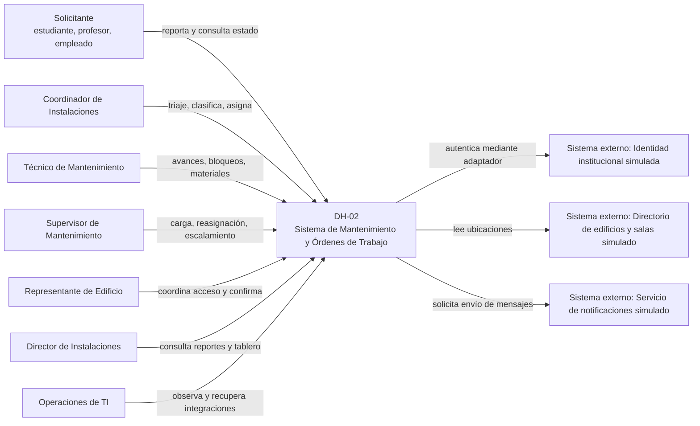

*Figura F01. DH-02 es dueño de solicitudes, triaje, órdenes y su historial. No es dueño de las credenciales, de la información de ubicaciones ni del proveedor de mensajes. Los contratistas externos no aparecen como usuarios directos (CL-010): su trabajo lo registra el coordinador o el supervisor.*

| Parte externa | DH-02 espera | DH-02 entrega | Consecuencia si falla |
|---|---|---|---|
| Identidad | Sujeto autenticado verificable | Inicio y retorno de la autenticación | El inicio de sesión falla de forma segura; no se inventan identidades |
| Directorio | Identificador, nombre, edificio, campus, estado y versión de cada espacio | Solo lecturas | Se opera con la última proyección vigente marcada como tal; sin proyección, se falla de forma segura |
| Notificaciones | Aceptación y, idealmente, deduplicación por clave | Mensajes mínimos con referencia al destinatario | El estado sigue disponible en DH-02; la entrega se registra aparte |

## 5.2 V-CONT — Contenedores

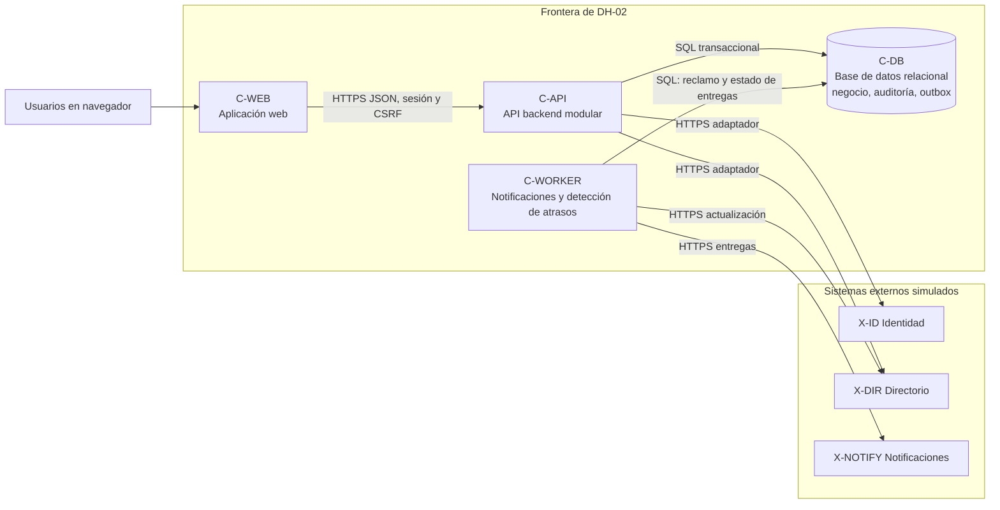

*Figura F02. El outbox vive dentro de C-DB; no hay un servidor de mensajería adicional.*

| Contenedor | Es responsable de | No es responsable de |
|---|---|---|
| C-WEB | Formularios, navegación, presentación accesible del estado | Decisiones de autorización, acceso directo a datos |
| C-API | Comandos de solicitud, triaje y órdenes; autorización; reglas de dominio; transacciones; lecturas | Trabajo que deba ocurrir fuera de la respuesta |
| C-WORKER | Entregas con *lease* y reintentos, actualización del directorio, detección de atrasos | Crear o modificar órdenes por su cuenta ni decidir triajes |
| C-DB | Registros duraderos, restricciones de integridad, auditoría y outbox | Decidir política institucional |

**Propuesta de tecnología** (a confirmar por el equipo): cliente web tipado (React/TypeScript), backend Python (FastAPI) con worker del mismo código, PostgreSQL. La arquitectura no depende de un framework concreto.

**Pila tecnológica definida para la versión final** (PR-01 resuelto). Las versiones se fijan exactamente en `requirements.txt` / `package-lock.json` para que el entorno sea reproducible (T-ENV-01).

| Capa | Tecnología | Versión |
|---|---|---|
| Lenguaje backend y worker | Python | 3.13 |
| Framework API (C-API) | FastAPI | 0.143.0 |
| Servidor ASGI | Uvicorn | 0.54.0 |
| Validación de datos | Pydantic | 2.14.0 |
| Acceso a datos (Unit of Work, repositorios) | SQLAlchemy | 2.1.4 |
| Migraciones de esquema | Alembic | 1.20.0 |
| Driver de PostgreSQL | psycopg | 3.3.6 |
| Cliente HTTP de los adaptadores | HTTPX | 0.28.1 |
| Base de datos (C-DB) | PostgreSQL | 17 |
| Entorno de ejecución frontend | Node.js | 24 LTS |
| Interfaz web (C-WEB) | React | 19.3.0 |
| Lenguaje frontend | TypeScript | 5.9.3 |
| Herramienta de build | Vite | 8.3.4 |
| Navegación | React Router | 8.4.0 |
| Consultas al API desde la interfaz | TanStack Query | 5.104.1 |
| Pruebas backend | pytest | 9.1.1 |
| Base real en pruebas de concurrencia (T-CON, T-TXN) | Testcontainers (Python) | 4.15.0 |
| Reglas de dependencias (T-ARCH-01) | import-linter | 2.15 |
| Pruebas frontend | Vitest | 5.0.3 |
| Lint y formato Python | Ruff | 0.17.0 |
| Entorno reproducible | Docker Engine + Docker Compose v2 | — |
| Proxy inverso con TLS | Nginx | 1.28 |
| Simuladores X-ID, X-DIR, X-NOTIFY | FastAPI (mismo stack) | 0.143.0 |

## 5.3 V-COMP — Componentes del backend

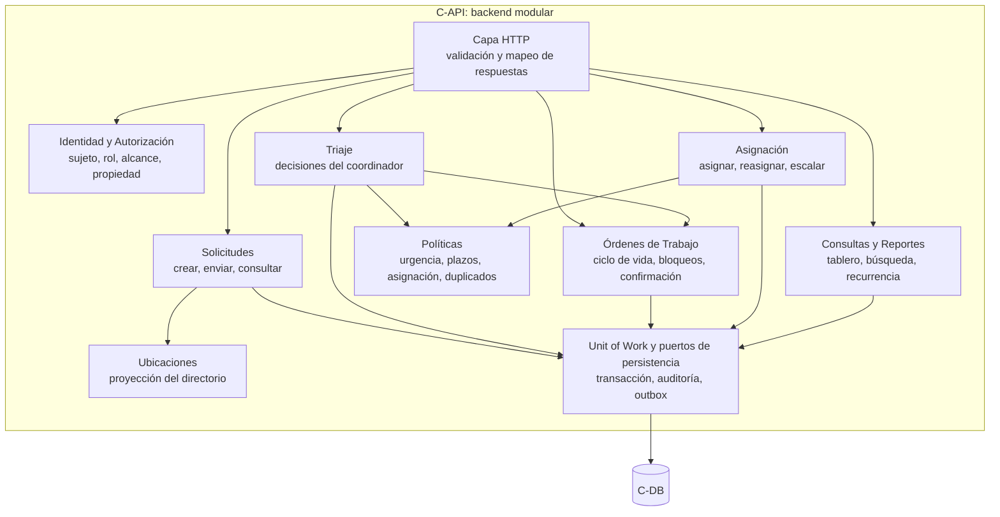

*Figura F03. Vista de responsabilidades y uso. Todos los servicios protegidos pasan por la autorización; solo se dibuja el borde principal para evitar ruido. Los módulos pueden ser paquetes de un mismo proceso.*

### Especificación del servicio crítico: `TriageApplicationService`

| Campo | Diseño |
|---|---|
| Propósito | Aplicar la decisión de triaje de forma autorizada y atómica |
| Operaciones | `decide(request_id, decision, context)` con acciones `APPROVE_CREATE_WO`, `REJECT`, `REDIRECT`, `LINK_TO_EXISTING`, `REQUEST_INFO` |
| Entradas | Actor autenticado, comando validado, versión esperada de la solicitud, clave de idempotencia, ID de correlación |
| Dependencias | Autorización, Unit of Work, `UrgencyPolicy`, `DuplicateCandidatePolicy`, repositorios de solicitud y orden, anexadores de auditoría y outbox |
| Estado propio | `TriageRecord`; coordina el cambio de estado de la solicitud y la creación de la orden |
| Contrato de fallo | Conflicto por duplicado, estado inválido, versión obsoleta, no autorizado, ubicación no válida, fallo temporal de infraestructura |
| Comportamiento prohibido | Llamar al servicio de notificaciones dentro de la transacción; aceptar roles o propietario desde el cliente; escribir la auditoría después del *commit* |
| Verificación | T-CON-01, T-CON-02, T-TXN-01, T-SEC-01 |

## 5.4 Estructura del código

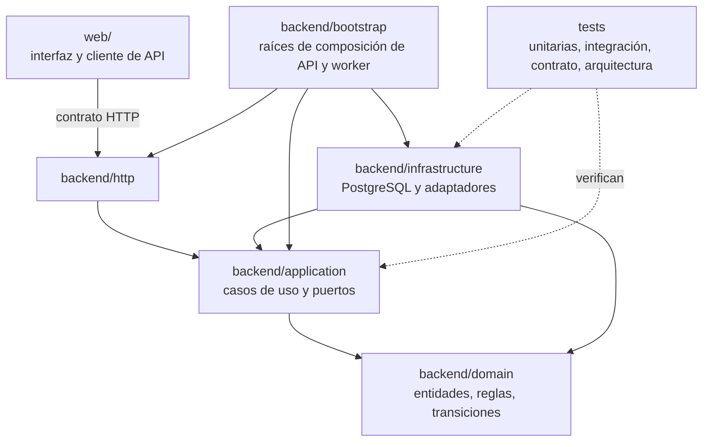

*Figura F04. Dirección de dependencias. El dominio no importa HTTP, SQL ni SDK de proveedores; T-ARCH-01 lo comprueba.*

## 5.5 V-DEP — Despliegue de demostración

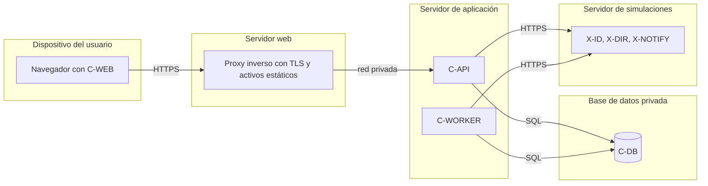

*Figura F05. Los "servidores" pueden ser contenedores lógicos en una sola máquina para el curso, pero eso no ofrece dominios de falla independientes. No es un diseño de alta disponibilidad.*

## 5.6 Consistencia entre vistas

| Elemento | Contexto | Contenedores | Componentes | Despliegue |
|---|---|---|---|---|
| DH-02 | Sistema | Frontera con 4 contenedores | Alcance de las especificaciones | Entorno de demostración |
| C-WEB | Oculto | Aplicación web | Formularios y cliente | Navegador + activos en servidor web |
| C-API | Oculto | API backend | Módulos de dominio | Proceso de aplicación |
| C-WORKER | Oculto | Worker | Entregas y detección de atrasos | Proceso worker |
| C-DB | Oculto | Base de datos | Repositorios | Servicio de base de datos |
| X-ID / X-DIR / X-NOTIFY | Sistemas externos | Conexiones externas | Puertos y adaptadores | Servidor de simulaciones |

---

# 6. Dominio, datos y estados

## 6.1 Modelo de dominio

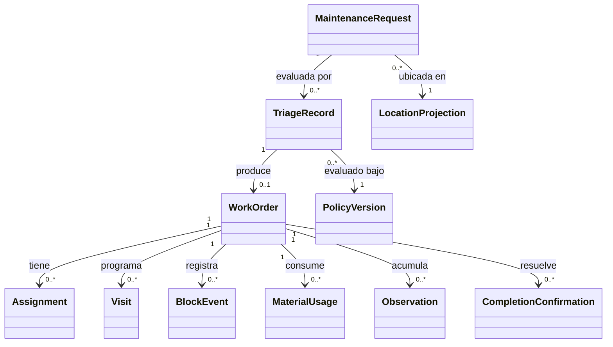

*Figura F06. Una solicitud puede tener varios registros de triaje (por ejemplo, "pedir información" y luego "aprobar"), pero produce como máximo una orden.*

## 6.2 Modelo relacional lógico

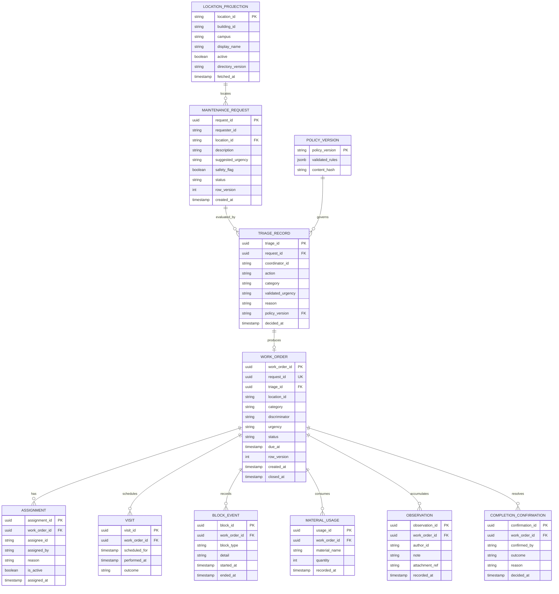

*Figura F07. Modelo lógico central. Los detalles y la nulabilidad se especifican en el diccionario de datos; no es un script de migración.*

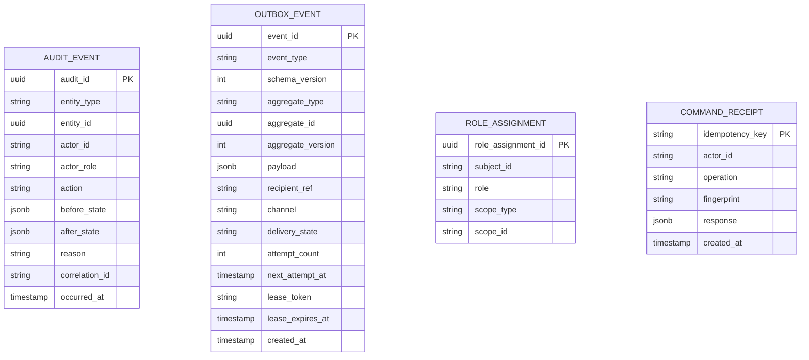

*Figura F08. Tablas de apoyo. La auditoría, la intención de integración y los intentos de entrega son conceptos distintos.*

## 6.3 Diccionario de datos: reglas que no caben en el diagrama

| Campo / registro | Significado y regla |
|---|---|
| `WorkOrder.request_id` | Único. Una solicitud produce a lo sumo una orden (BR-02). |
| `WorkOrder.(location_id, category, discriminator)` | Índice único **parcial** para estados activos. `discriminator` vacío por defecto; el coordinador declara uno propio solo para un problema distinto (BR-03). |
| `WorkOrder.urgency` / `TriageRecord.validated_urgency` | Se conserva también la `suggested_urgency` del solicitante (BR-04). |
| `WorkOrder.due_at` | Calculado con la `SlaPolicy` vigente al crear la orden. Se desplaza por la duración de cada `BlockEvent` de tipo `MATERIALS` o `ACCESS` al cerrarse (E2-AS-04). |
| `WorkOrder.row_version` | Control optimista; se incrementa en cada transición aceptada. |
| `BlockEvent` | Un bloqueo es un evento con inicio y fin, no un campo de texto: conserva el historial y permite medir demoras. `block_type`: `MATERIALS`, `ACCESS`, `CONTRACTOR`, `APPROVAL`. Solo `MATERIALS` y `ACCESS` pausan el SLA (E2-AS-04). |
| `Assignment.is_active` | Una sola asignación activa por técnico y orden; las anteriores se conservan. |
| `CompletionConfirmation.outcome` | `CONFIRMED`, `REJECTED_REOPEN`, `ADMIN_CLOSED`. Registra quién y por qué. |
| `Observation.attachment_ref` | Referencia simulada; no se almacenan archivos reales (E2-AS-08). |
| `LocationProjection.fetched_at` | Momento local de la última actualización válida; no sustituye la versión del directorio. |
| `AuditEvent` | Solo anexado para los roles de la aplicación. No se actualiza ni se borra. |
| `OutboxEvent` | Describe la versión confirmada del agregado, no lo que exista cuando el worker lea la base. Esquemas desconocidos se ponen en cuarentena. |
| `CommandReceipt` | Resultado de un comando exitoso para reintentos idempotentes. Retención propuesta: 24 h. |

Los campos de texto libre tienen límites de tamaño y no se copian indiscriminadamente a logs ni a mensajes. Los datos son sintéticos.

## 6.4 Invariantes y qué las garantiza

| Invariante | Mecanismo principal | Evidencia de apoyo |
|---|---|---|
| Una solicitud produce a lo sumo una orden | `UNIQUE(work_order.request_id)` | T-CON-01 (variante misma solicitud) |
| No hay dos órdenes activas con la misma (ubicación, categoría, discriminador) | Índice único parcial | T-CON-01, T-CON-02 |
| Mutación + auditoría + outbox se confirman juntos | Una sola transacción (Unit of Work) | T-TXN-01 |
| Solo transiciones legales | Tabla de transiciones + guarda de versión | T-FUN-02, T-FUN-03 |
| Actor no autorizado no modifica estado | Autorización en servidor antes del comando | T-SEC-01/02 |
| La orden sigue consistente si falla una notificación | Notificación fuera de la transacción de negocio | T-INT-01 |
| Ubicación válida | Validación contra `LocationProjection` | T-CONTRACT-01 |

Ninguna restricción, diagrama o prueba por sí sola demuestra toda la arquitectura.

## 6.5 Ciclo de vida de la solicitud

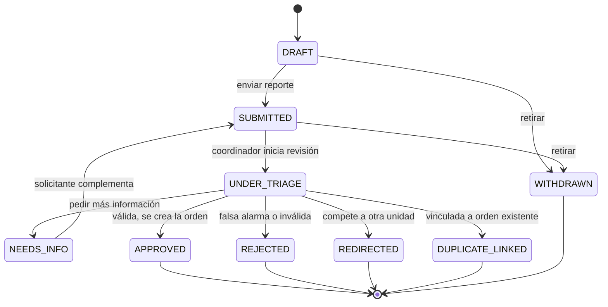

*Figura F09. Dimensión 1: estado de la solicitud. `APPROVED` significa que la orden fue creada en la misma transacción.*

## 6.6 Ciclo de vida de la orden de trabajo

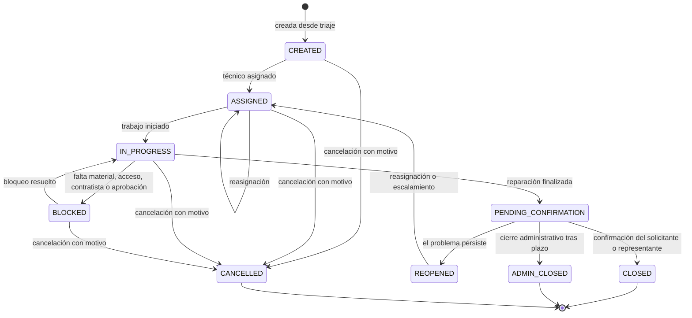

*Figura F10. Dimensión 2: estado de la orden. Se usa un único estado `BLOCKED` con un `BlockEvent` tipificado, en lugar de un estado por motivo, para que agregar un tipo no cambie el modelo de estados. "Atrasada" y "escalada" **no** son estados: se derivan de `due_at` y de eventos de escalamiento.*

### Tabla de transiciones

| Transición | Actor y guarda | Efectos confirmados en la misma transacción |
|---|---|---|
| `UNDER_TRIAGE → APPROVED` | Coordinador con alcance; no es el solicitante; ubicación válida; sin duplicado sin resolver | Crear `TriageRecord` y `WorkOrder` (`CREATED`), calcular `due_at`, auditar, outbox |
| `UNDER_TRIAGE → DUPLICATE_LINKED` | Coordinador; orden existente activa en misma ubicación y categoría | Vincular, auditar, notificar al solicitante |
| `UNDER_TRIAGE → REJECTED / REDIRECTED` | Coordinador; motivo obligatorio | Registrar motivo, auditar, notificar |
| `CREATED → ASSIGNED` / reasignación | Coordinador o supervisor; técnico con especialidad y activo | Nueva `Assignment` activa, desactivar la anterior, auditar, outbox |
| `ASSIGNED → IN_PROGRESS` | Técnico asignado | Auditar |
| `IN_PROGRESS → BLOCKED` | Técnico asignado; tipo de bloqueo obligatorio | `BlockEvent`, auditar, outbox al supervisor (BR-06) |
| `BLOCKED → IN_PROGRESS` | Técnico, coordinador o supervisor | Cerrar `BlockEvent`, auditar |
| `IN_PROGRESS → PENDING_CONFIRMATION` | Técnico asignado; observaciones registradas | Auditar, outbox al solicitante y al representante |
| `PENDING_CONFIRMATION → CLOSED` | Solicitante o representante del edificio de la orden | `CompletionConfirmation`, auditar, outbox |
| `PENDING_CONFIRMATION → REOPENED` | Solicitante o representante | Motivo, auditar, outbox al supervisor |
| `PENDING_CONFIRMATION → ADMIN_CLOSED` | Supervisor; plazo vencido *(provisional)* | Motivo obligatorio, auditar |
| Cualquier estado activo `→ CANCELLED` | Coordinador o supervisor; motivo | Cerrar asignaciones, auditar, outbox |

## 6.7 Estado de las notificaciones

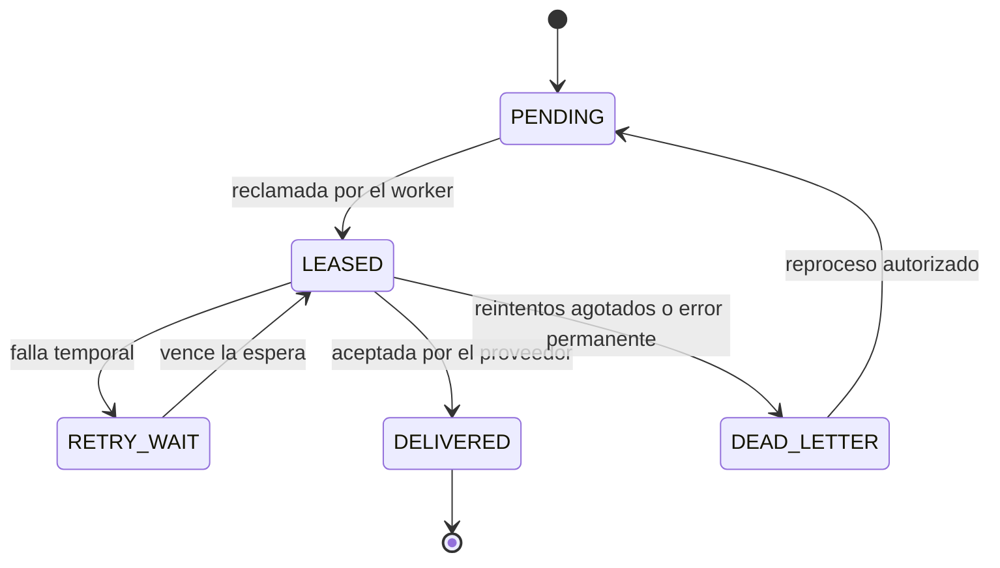

*Figura F11. Dimensión 3: estado de la entrega, independiente de las otras dos.*

## 6.8 Tres dimensiones independientes

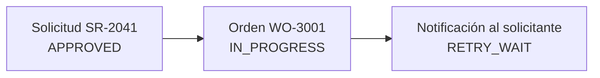

*Figura F12. Combinación legítima: la solicitud fue aprobada, la reparación avanza y el correo está en reintento. Una falla de notificación no se muestra como "orden fallida", ni una solicitud aprobada como "trabajo terminado".*

---

# 7. Interacciones críticas y comportamiento ante fallos

## 7.1 V-SEQ-01 — Triaje que crea la orden

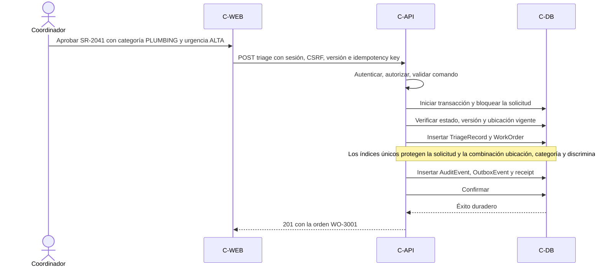

*Figura F13. Si una restricción falla, toda la transacción se revierte y se responde con un error de negocio.*

## 7.2 V-SEQ-02 — Carrera entre dos coordinadores

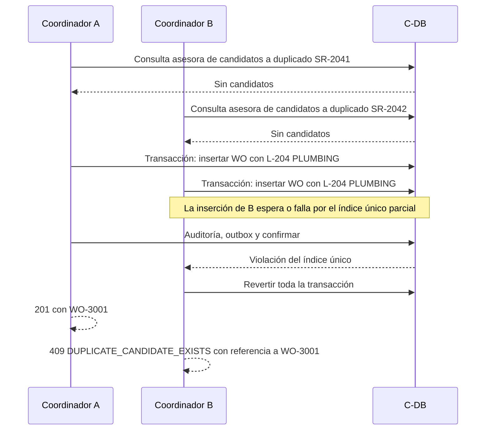

*Figura F14. Cuál de los dos gana no está especificado; lo que se garantiza es que no existan dos órdenes activas indebidas. Se prueba con conexiones independientes contra la base real, no con un repositorio simulado en memoria.*

## 7.3 V-SEQ-03 — Bloqueo por materiales y caída de notificaciones

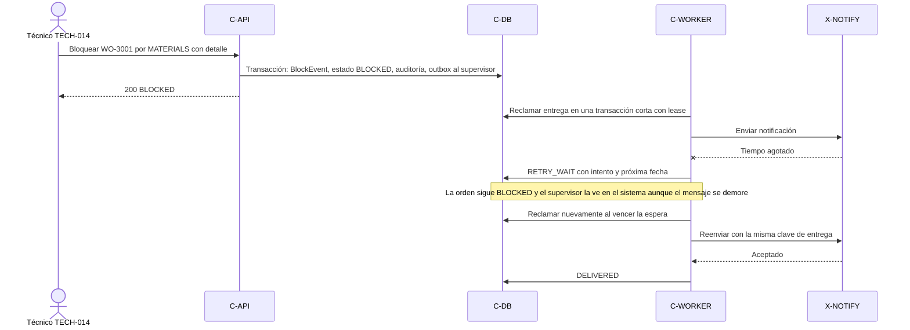

*Figura F15. La intención de notificar sobrevive a la falla. Un reintento tras un envío ya aceptado se evita con una clave estable y un receptor que deduplica.*

## 7.4 V-SEQ-04 — Detección de atraso y escalamiento

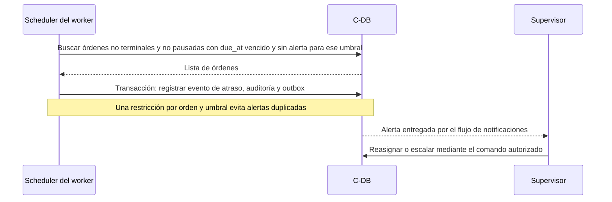

*Figura F16. El atraso se calcula; no se guarda como estado de la orden. Las órdenes pausadas por bloqueo de materiales o acceso no se evalúan (E2-AS-04).*

## 7.5 Matriz de fallos

| Punto de falla | Resultado duradero requerido | Resultado para usuario u operador |
|---|---|---|
| Comando inválido o no autorizado | Sin mutación de negocio | Error 4xx definido; registro de seguridad operativo |
| Conflicto de unicidad en triaje | Transacción completa revertida | 409 con referencia a la orden existente; sin auditoría de éxito |
| Falla de base de datos antes del commit | Sin éxito reconocido | Falla temporal; reintento con la misma clave |
| Commit exitoso y respuesta perdida | Orden y receipt existen | El reintento reproduce el resultado registrado |
| Confirmación del commit perdida | Resultado incierto hasta reconciliar | Resolver por receipt o estado actual; no suponer rollback |
| Worker cae antes de enviar | Entrega reclamable | Reintento tras vencer el lease |
| Worker cae después de enviar | El receptor pudo aplicar el efecto | Mismo identificador de entrega; el lease evita acuses obsoletos |
| Directorio no disponible, con proyección ≤ 24 h | Se opera con la proyección marcada | Aviso de datos no actualizados |
| Directorio no disponible, sin proyección | Sin solicitud aceptada con ubicación sin validar | 503 con recuperación posterior |
| Notificación con error permanente | Orden intacta; entrega retenida | `DEAD_LETTER` y procedimiento de recuperación |

Cada fila necesita una prueba, una inspección o un hueco de validación reconocido.

---

# 8. Interfaces y contratos

## 8.1 Catálogo de endpoints (contrato propuesto, no implementado)

Todas las rutas son relativas a `/api/v1`. Los comandos que mutan estado requieren sesión, protección CSRF y autorización en servidor; los que pueden reintentarse llevan `Idempotency-Key`, y los que modifican recursos versionados, `If-Match`.

| Endpoint | Responsabilidad | Regla de contrato importante |
|---|---|---|
| `GET /locations` | Buscar edificios y salas | Paginado; muestra antigüedad de la proyección |
| `POST /requests` | Crear borrador propio | El propietario se deriva de la sesión, no del cuerpo |
| `POST /requests/{id}/submissions` | Enviar la solicitud | Congela el contenido; valida ubicación; idempotente |
| `GET /requests` · `GET /requests/{id}` | Mis solicitudes / detalle autorizado | Un solicitante solo ve las propias |
| `GET /requests/{id}/status` | Estado combinado de solicitud, orden y notificación | Autorizado y no cacheable |
| `POST /requests/{id}/triage` | Decisión del coordinador | Acciones: `APPROVE_CREATE_WO`, `REJECT`, `REDIRECT`, `LINK_TO_EXISTING`, `REQUEST_INFO`; versión y clave obligatorias |
| `POST /work-orders/{id}/assignments` | Asignar o reasignar | Coordinador o supervisor; motivo en reasignaciones |
| `POST /work-orders/{id}/start` | Iniciar trabajo | Solo el técnico asignado |
| `POST /work-orders/{id}/blocks` · `.../blocks/{blockId}/resolution` | Bloquear y resolver | Tipo de bloqueo obligatorio |
| `POST /work-orders/{id}/materials` · `.../observations` · `.../visits` | Registrar trabajo realizado | Observaciones con referencia simulada de evidencia |
| `POST /work-orders/{id}/completions` | Marcar finalizada | Pasa a `PENDING_CONFIRMATION` |
| `POST /work-orders/{id}/confirmations` | Confirmar o reabrir | Solicitante o representante del edificio de la orden |
| `POST /work-orders/{id}/admin-closures` | Cierre administrativo | Worker (actor de sistema) al vencer el plazo de 7 días hábiles; el supervisor conserva el comando manual (§9.1) *(suposición formal; confirmar)* |
| `POST /work-orders/{id}/escalations` | Escalar | Supervisor; motivo |
| `GET /work-orders` | Búsqueda y filtros | Paginado; filtrado por rol y alcance |
| `GET /work-orders/{id}/history` | Historial de auditoría | Solo roles autorizados |
| `GET /technicians/workload` | Carga actual | Supervisor y coordinador |
| `GET /reports/{type}` | Pendientes, tiempos, atrasos, recurrencia | Filtros explícitos y campos permitidos |
| `POST /deliveries/{id}/replays` | Reprocesar una entrega fallida | Rol de operaciones; motivo; auditado |

## 8.2 Intercambio completo: triaje que crea la orden

```http
POST /api/v1/requests/SR-2041/triage HTTP/1.1
Content-Type: application/json
Cookie: dh02_session=<valor-opaco>
X-CSRF-Token: <token-asociado-a-la-sesión>
If-Match: "request-SR-2041-v3"
Idempotency-Key: triage-sr2041-001

{
  "action": "APPROVE_CREATE_WO",
  "category": "PLUMBING",
  "validatedUrgency": "HIGH",
  "safetyFlag": false,
  "discriminator": "",
  "assigneeId": "TECH-014",
  "comments": "Fuga de tubería validada en laboratorio."
}
```

```http
HTTP/1.1 201 Created
Location: /api/v1/work-orders/WO-3001
ETag: "work-order-WO-3001-v1"
Content-Type: application/json

{
  "triageId": "TRG-9902",
  "requestId": "SR-2041",
  "requestStatus": "APPROVED",
  "workOrder": {
    "workOrderId": "WO-3001",
    "status": "ASSIGNED",
    "assigneeId": "TECH-014",
    "urgency": "HIGH",
    "dueAt": "2026-10-07T14:30:00Z",
    "createdAt": "2026-10-06T14:30:00Z"
  }
}
```

La precondición protege la versión de la **solicitud**; el `ETag` de la respuesta describe la **orden** creada. El progreso de las notificaciones se consulta en `GET /requests/{id}/status`: que esté pendiente no debilita el estado de la orden. El formato de comandos e idempotencia es una convención de diseño de este proyecto, no una propiedad automática de HTTP.

## 8.3 Errores

| Código HTTP | Código de negocio | Significado y recuperación |
|---|---|---|
| 400 | `REQUIRED_HEADER_MISSING` | Falta la clave, la precondición o el token CSRF |
| 401 | `SESSION_INVALID` | Volver a autenticarse |
| 403 | `ACTION_FORBIDDEN` | Sin permiso para esta acción o alcance; no reintentar |
| 404 | `RESOURCE_NOT_FOUND` | No existe, o se oculta a quien no está autorizado |
| 409 | `DUPLICATE_CANDIDATE_EXISTS` | Ya hay una orden activa para esa ubicación y categoría. Vincular la solicitud (`LINK_TO_EXISTING`) o declarar un `discriminator` si es un problema distinto |
| 409 | `INVALID_STATE_TRANSITION` | La transición no es legal desde el estado actual |
| 409 | `IDEMPOTENCY_KEY_REUSED` | Misma clave con un comando diferente |
| 412 | `PRECONDITION_FAILED` | Recargar y reconciliar antes de reenviar |
| 422 | `VALIDATION_FAILED` | Corregir los campos indicados |
| 503 | `LOCATION_DIRECTORY_UNAVAILABLE` | Sin proyección vigente; reintentar tras la recuperación |

Formato de error (estilo RFC 9457). El mensaje no revela datos de otros usuarios:

```json
{
  "type": "urn:dh02:problem:duplicate-candidate",
  "title": "Ya existe una orden activa para esta ubicación y categoría",
  "status": 409,
  "code": "DUPLICATE_CANDIDATE_EXISTS",
  "detail": "No se creó una nueva orden. Vincule la solicitud a la orden existente o indique que se trata de un problema distinto.",
  "instance": "/api/v1/requests/SR-2042/triage",
  "existingWorkOrderId": "WO-3001",
  "correlationId": "corr-demo-2042"
}
```

## 8.4 Reintentos e idempotencia

| Situación | Comportamiento requerido |
|---|---|
| Misma clave y mismo contenido, con receipt exitoso | Reautorizar y reproducir la respuesta registrada, antes de rechazar la precondición ya vieja |
| Misma clave, contenido distinto | 409; no reinterpretar como un comando nuevo |
| Duplicados concurrentes | La unicidad del receipt los serializa; el perdedor observa el resultado confirmado |
| Falla segura antes del commit | No hay receipt; el reintento puede ejecutarse |
| Receipt expirado | La clave ya no prueba ejecución previa; se reconcilia con el estado actual. La unicidad por solicitud evita una segunda orden |

## 8.5 Contrato del directorio de espacios (simulado)

```json
{
  "locationId": "CIE-L-204",
  "buildingId": "CIE",
  "campus": "NORTE",
  "displayName": "Laboratorio de Química L-204",
  "active": true,
  "restrictedAccess": true,
  "buildingRepresentativeId": "rep-CIE-01",
  "directoryVersion": "DIR-v118",
  "sourceRevision": 118
}
```

El adaptador valida esquema, identificador conocido y un `sourceRevision` monótono (rechaza proyecciones que retrocedan). `directoryVersion` es un token opaco, no se ordena. `fetched_at` es la marca local. La antigüedad máxima aceptada para recibir solicitudes es de 24 h *(E2-AS-05)*; si no hay proyección vigente se falla de forma segura. Una copia local no es un bloqueo distribuido del directorio: la simulación asume datos controlados.

## 8.6 Contrato de notificaciones

Evento interno (describe la versión confirmada, no el estado actual de la base):

```json
{
  "eventId": "EV-3001-2",
  "eventType": "WorkOrderBlocked",
  "schemaVersion": 1,
  "aggregateType": "WorkOrder",
  "aggregateId": "WO-3001",
  "aggregateVersion": 4,
  "requestId": "SR-2041",
  "occurredAt": "2026-10-06T16:10:00Z",
  "correlationId": "corr-demo-3001",
  "payload": { "blockType": "MATERIALS", "status": "BLOCKED" }
}
```

| Evento | Destinatarios típicos |
|---|---|
| `RequestSubmitted` | Solicitante; coordinador |
| `RequestTriaged` (aprobada, rechazada, redirigida, vinculada, información requerida) | Solicitante |
| `WorkOrderAssigned` | Técnico; solicitante |
| `WorkOrderBlocked` | Supervisor |
| `WorkOrderPendingConfirmation` | Solicitante; representante de edificio |
| `WorkOrderReopened` | Supervisor; técnico |
| `WorkOrderOverdue` / `WorkOrderEscalated` | Supervisor |
| `SafetyFlagRaised` | Supervisor; coordinador |

Los mensajes llevan una plantilla mínima: no incluyen notas internas ni el historial. Esquemas desconocidos se ponen en cuarentena. Si el proveedor real no deduplica, el riesgo de mensajes repetidos se documenta (R-013), no se oculta.

## 8.7 Navegación y estados de interfaz

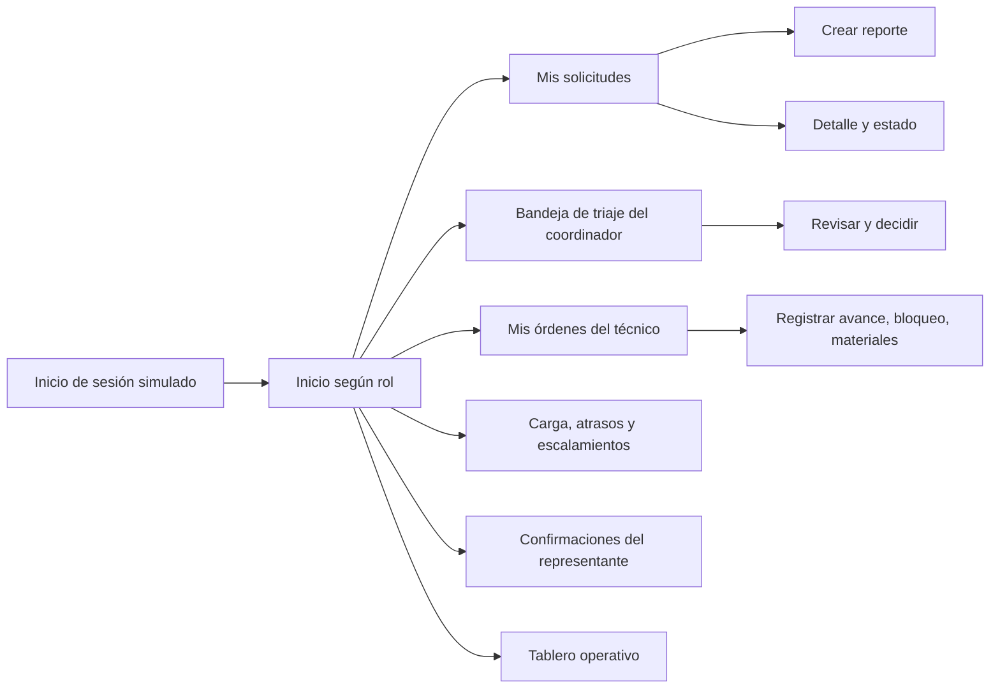

*Figura F17. Navegación por responsabilidades. Ocultar un botón es una decisión de usabilidad, no un límite de autorización: la API aplica las reglas aunque se la invoque sin la interfaz.*

| Interacción | Regla de diseño |
|---|---|
| Estado | Mostrar por separado: estado de la solicitud, de la orden y de la notificación; texto, no solo color |
| Triaje | Mostrar la urgencia sugerida junto a la validada y los candidatos a duplicado |
| Conflicto | Conservar lo ingresado y explicar cómo resolver (vincular o declarar problema distinto) |
| Doble clic o *timeout* | Deshabilitar el reenvío en la interfaz, pero basar la corrección en la clave y la restricción del servidor |
| Accesibilidad | Etiquetas, navegación por teclado, foco visible, cambios de estado anunciados; se prueba, no se certifica |
| Fechas | Mostrar la zona horaria; almacenar en UTC |

---

# 9. Seguridad, privacidad y despliegue

## 9.1 Matriz de autorización

El rol es solo una parte. Se verifican también alcance (edificio/campus), propiedad y estado actual. Se niega por defecto. *(Valores propuestos, pendientes de validar.)*

| Acción | Solicitante | Coordinador | Técnico | Supervisor | Rep. de edificio | Director | Operaciones |
|---|---|---|---|---|---|---|---|
| Crear y ver solicitud propia | Sí (propia) | Según su rol | Según su rol | Según su rol | Según su rol | — | Sin acceso automático |
| Triaje | No | Sí, en su alcance, no la propia | No | Sí (suplencia) | No | No | No |
| Crear orden | No | Sí | No | Sí | No | No | No |
| Asignar / reasignar | No | Sí | No | Sí | No | No | No |
| Ver orden | Solo la suya | Su alcance | Solo las asignadas | Su alcance | Las de su edificio | Reportes | Solo metadatos de diagnóstico |
| Iniciar, bloquear, registrar materiales | No | No | Solo asignadas | No | No | No | No |
| Marcar finalizada | No | No | Solo asignadas | No | No | No | No |
| Confirmar o reabrir | Solo su solicitud | No | No | No | Edificio de la orden | No | No |
| Cierre administrativo | No | No | No | Sí | No | No | No |
| Reducir urgencia con bandera de seguridad | No | No | No | Sí | No | No | No |
| Ver notas internas y bandera de seguridad | No | Sí | Asignadas | Sí | Su edificio, sin notas internas | No | No |
| Ver reportes y tablero | No | Parcial | No | Sí | No | Sí | No |
| Reprocesar una entrega fallida | No | No | No | No | No | No | Sí, con motivo |

El solicitante solo ve el estado y los datos que él aportó. La información relacionada con seguridad se limita a quienes la necesitan para actuar.

## 9.2 Autenticación

La autenticación se hace a través de un adaptador institucional simulado. El servidor valida el resultado, resuelve las asignaciones de rol locales (`ROLE_ASSIGNMENT`) y emite una cookie de sesión opaca `HttpOnly`. Los comandos que mutan llevan un token CSRF. Una autenticación simulada no demuestra una integración real. En un entorno real debe usarse una librería mantenida y el protocolo completo, no un análisis manual de tokens.

## 9.3 Fronteras de confianza

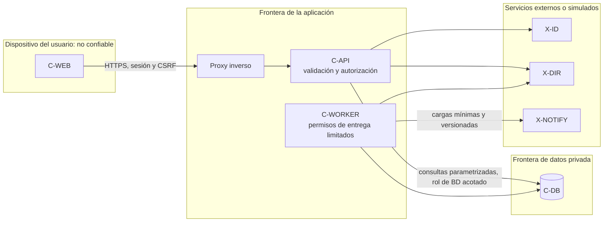

*Figura F18. La ubicación en la red ayuda a restringir accesos, pero no sustituye la autorización en la aplicación.*

Clasificación de datos: ubicaciones (bajo riesgo); descripciones, identificadores de personas y datos de contacto (restringidos); información de seguridad (restringida y acotada); material de autenticación (sensible, nunca en logs ni en cargas de negocio); diagnósticos operativos.

## 9.4 Modelo de amenazas

| Amenaza | Activo | Mitigación | Verificación |
|---|---|---|---|
| Un solicitante adivina el ID de una solicitud ajena | Detalle de solicitudes | Verificación de propiedad y alcance por objeto; ocultar existencia cuando corresponda | T-SEC-01 |
| Un técnico opera una orden no asignada | Integridad de la ejecución | Verificar asignación activa y estado | T-SEC-01 |
| Un coordinador triagea su propia solicitud | Separación de funciones | Regla BR-10 en el servidor | T-SEC-02 |
| El navegador envía propietario o estado falsificados | Integridad de negocio | El actor se deriva de la sesión; solo transiciones legales | T-SEC-03 |
| Petición entre sitios cancela o cierra una orden | Disponibilidad y trazabilidad | CSRF, política de cookies, verificación de origen | T-SEC-04 |
| Inyección o texto malicioso en descripciones | BD y usuarios | Consultas parametrizadas, límites de tamaño, codificación de salida | T-SEC-05 |
| Datos externos duplicados, desordenados o falsificados | Integración | Validación de esquema, claves estables, versiones | T-CONTRACT-01 |
| Fuga de secretos o datos en logs | Credenciales y privacidad | Secretos fuera del código; errores sanitizados | T-SEC-06 |
| Administrador de BD altera la auditoría | Confianza en el historial | Riesgo residual reconocido (R-014); requeriría controles independientes en producción | — |

Es una revisión acotada: no es una prueba de penetración ni una afirmación de cumplimiento normativo.

## 9.5 Supuestos de despliegue y configuración

| Supuesto | Valor de ejemplo | Qué documentar |
|---|---|---|
| Compatibilidad API/worker/esquema | Misma versión de aplicación y migraciones | Versiones según la tabla de §5.2; dependencias fijadas y migraciones con Alembic |
| Persistencia | Base de datos relacional con volumen persistente | Diferencia entre reiniciar un proceso y perder datos |
| Sistemas externos | Identidad, directorio y notificaciones simulados | Contrato y qué comportamiento real no verifica la simulación |
| Frescura del directorio | 24 h para recibir solicitudes | Por qué ese valor y qué pasa sin datos vigentes |
| Recuperación de entregas | Sondeo 2 s; timeout 5 s; 12 intentos; lease 15 s | Calendario de reintentos y comportamiento al agotarse |
| Detección de atrasos | Revisión cada 60 s | Qué ocurre si el worker está detenido |
| Receipts de comandos | Retención de 24 h | Ventana de reintento |
| Seguridad | Secretos inyectados; BD privada | Quién accede a qué |
| Reproducibilidad | Datos sintéticos y perfil de entorno explícito | Instrucciones de inicio, datos semilla y límites reales |

Estos son supuestos del diseño propuesto; no se afirma que el entorno esté desplegado. Un solo despliegue de API, worker y base de datos no es alta disponibilidad.

## 9.6 Señales de observabilidad

| Señal | Interpretación | Acción propuesta |
|---|---|---|
| Resultados de triaje por código | Distingue contención legítima de fallas reales | Investigar fallos inesperados; no alertar por cada duplicado legítimo |
| Antigüedad de la entrega pendiente más vieja | El worker no avanza | Revisar tras 60 s |
| Cantidad en `DEAD_LETTER` por destino | Requiere intervención humana | Diagnosticar y reprocesar con motivo |
| Expiración de leases / intentos repetidos | Caídas del worker o inestabilidad externa | Revisar salud y proveedor |
| Antigüedad de la proyección del directorio | Posible bloqueo de solicitudes | Restaurar el acceso; no omitir la validación en silencio |
| Denegaciones de autorización por acción | Mala configuración o abuso | Revisar asignaciones de rol |
| Órdenes atrasadas sin alerta | Falla del job de atrasos | Revisar el scheduler |

Se correlacionan comando, auditoría, evento y entrega mediante identificadores. Se registran códigos de error y duraciones sanitizados, sin cookies, tokens ni texto privado. **Auditoría de negocio**, **registros de seguridad** y **logs operativos** son cosas distintas, aunque compartan plataforma.

---

# 10. Validación y estado de la evidencia

## 10.1 Prueba de concepto propuesta

Probar la suposición más arriesgada, no la pantalla más vistosa: que la base de datos real garantiza la unicidad bajo concurrencia y que mutación, auditoría y outbox se confirman de forma atómica.

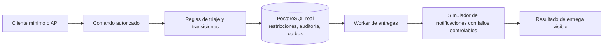

*Figura F19. Corte vertical: solicitud → triaje → orden → asignación → bloqueo → finalización → confirmación → cierre, con auditoría. Se usa la base real; un repositorio en memoria no puede ejercitar el riesgo de concurrencia.*

Ataques al corte: dos aprobaciones simultáneas, detener el servicio de notificaciones, reiniciar el worker, repetir un comando aceptado, intento no autorizado. Toda rama diseñada pero no implementada se marca como tal.

> **Estado de la PoC (al 2026-10-11): todavía no implementada.** No existe código de los endpoints de solicitud, del triaje ni de la tabla Outbox. La carpeta `/poc/` del repositorio solo contiene la estructura de directorios (§11.4), lista para empezar la implementación.

## 10.2 Niveles de verificación

| Nivel | Qué puede demostrar | Qué no puede demostrar por sí solo |
|---|---|---|
| Unitaria de dominio y políticas | Reglas, transiciones y selección de asignación deterministas | Concurrencia real o recuperación del proveedor |
| Integración con base de datos | Restricciones, rollback, acoplamiento transaccional | Autenticación extremo a extremo e interpretación del usuario |
| Integración de API | Autorización, precondiciones, receipts | Integración productiva real (se usan simulaciones) |
| Concurrencia / inyección de fallos | Comportamiento en carreras y caídas elegidas | Todas las interleavings posibles |
| Contrato | Adaptadores y simulaciones coinciden | Comportamiento no documentado de un proveedor real |
| Prueba de tareas con usuarios | Si participantes concretos entienden el estado | Usabilidad universal o certificación de accesibilidad |
| Despliegue / humo | Arranque reproducible del flujo de demostración | Alta disponibilidad o recuperación ante pérdida de datos |
| Revisión de arquitectura | Dirección de dependencias y consistencia | Corrección funcional |

## 10.3 Catálogo inicial de pruebas

**Estado de todas: NOT EXECUTED.** Al 2026-10-11 no se ha ejecutado ninguna prueba: el proyecto está en la etapa de diseño y el código de la PoC aún no existe. Los resultados esperados son aserciones por verificar, no resultados. Cuando una prueba se ejecute, se actualiza su estado (PASSED/FAILED) con el comando, el commit y el entorno en §10.4.

| ID | Procedimiento | Aserciones esperadas |
|---|---|---|
| T-FUN-01 | Flujo completo con datos sintéticos: solicitud, triaje, orden, asignación, inicio, finalización, confirmación, cierre | Cada transición legal con su auditoría; estado visible al solicitante en cada paso (SC-01, SC-02, SC-04) |
| T-FUN-02 | Bloquear y desbloquear una orden con cada tipo de bloqueo; transiciones ilegales | Solo transiciones válidas; `BlockEvent` con inicio y fin; el supervisor es notificado |
| T-FUN-03 | Confirmar, reabrir y cerrar administrativamente | Actor correcto en cada caso; reapertura devuelve la orden al flujo; motivo registrado |
| T-FUN-04 | Redirigir, rechazar y pedir información | Motivo obligatorio; la solicitud no genera orden |
| T-FUN-05 | Búsqueda, filtros y reportes con alcances permitidos y prohibidos | Resultados acotados y filtrados por rol; coherencia de definiciones (SC-07) |
| T-CON-01 | 100 carreras coordinadas de dos aprobaciones (misma ubicación y categoría) con conexiones independientes; variante con la misma solicitud | Un éxito y un 409 por ensayo; sin pares activos indebidos; efectos de éxito solo en el ganador |
| T-CON-02 | Casos límite: `discriminator` distinto, orden cerrada previa, solicitud repetida, ubicaciones distintas | Comportamiento exacto en los límites; errores de restricción traducidos a errores de negocio |
| T-TXN-01 | Inyectar fallo entre orden, auditoría, outbox, receipt y COMMIT | Reversión total; sin registros huérfanos; resultado incierto resuelto por receipt |
| T-API-01 | Reintentar un comando exitoso tras perder la respuesta | Reproduce el resultado; sin mutación adicional |
| T-API-02 | Reutilizar la clave con contenido distinto | 409 sin reinterpretar |
| T-API-03 | Enviar versiones obsoletas | 412 sin efectos |
| T-AUD-01 | Ejecutar cada mutación aceptada y consultar el historial con actores permitidos y prohibidos | Campos requeridos presentes; sin éxito falso tras reversión; acceso controlado (SC-05) |
| T-POL-01 | Tabla de casos de urgencia y plazos por política | Resultado esperado por caso; política malformada rechazada |
| T-POL-02 | Instalar `POL-002` y comparar con `POL-001` | Nuevo cálculo para nuevas solicitudes; las órdenes en curso conservan su versión |
| T-SLA-01 | Cruzar `due_at` con órdenes en distintos estados, incluidas bloqueadas por `MATERIALS` y `ACCESS` | Atraso detectado ≤ 5 min; una alerta por umbral; las terminales se excluyen (SC-06); una orden pausada no se marca atrasada y, al reanudar, `due_at` se desplaza por la duración del bloqueo |
| T-SAF-01 | Solicitud con bandera de seguridad | Urgencia forzada; evento atómico con el triaje; solo el supervisor reduce *(provisional)* |
| T-INT-01 | Notificaciones caídas 2 minutos tras asignar | Orden preservada; entrega diferida; completada ≤ 60 s tras restaurar |
| T-INT-02 | Caída del worker tras envío aceptado | La clave estable evita efectos duplicados; el lease obsoleto no confirma |
| T-CONTRACT-01 | Respuestas inválidas del directorio y de notificaciones | Datos inválidos rechazados o en cuarentena; sin degradar proyecciones |
| T-SEC-01 | Matriz de lectura y mutación por rol, propiedad y alcance (con control positivo) | Solo acciones autorizadas; sin fuga de campos |
| T-SEC-02 | Triaje y confirmación de la propia solicitud; rol inactivo | Denegado; sin escrituras |
| T-SEC-03 | Propietario y estado falsificados en el cuerpo | Ignorados o rechazados |
| T-SEC-04 | CSRF ausente, sesión expirada | Falla documentada, sin efecto |
| T-SEC-05 | Cadenas de inyección y entradas sobredimensionadas | Almacenamiento parametrizado y salida codificada |
| T-SEC-06 | Inspección de código, configuración, logs y mensajes | Sin secretos ni datos innecesarios |
| T-PERF-01 | 100 envíos en 10 minutos con datos sintéticos | Sin pérdidas; p95 documentado; recursos reales reportados |
| T-ARCH-01 | Inspección de dependencias y reemplazo de un adaptador | El dominio no importa HTTP, SQL ni SDK de proveedores |
| T-ENV-01 | Arranque desde cero con datos semilla | Instrucciones suficientes; un corte vertical funcionando |
| T-REC-01 | Reiniciar API y worker conservando la BD | Estado confirmado intacto; entregas recuperadas |

## 10.4 Registro de evidencia (plantilla)

```yaml
test_id: T-CON-01
status: NOT_EXECUTED        # cambia a PASSED / FAILED tras una ejecución real
source_commit: null         # sin código de PoC todavía
code_refs: null             # PoC no implementada; irá en /poc/backend y /poc/tests
executed_at: null
executor: null
environment: { os: null, runtime: null, database: null, migration: null }
fixture: { version: null, reset_procedure: null }
execution: { command: null, independent_connections: null, trials: null, raw_output: null }
assertions:
  expected: "Un éxito y un conflicto por ensayo sano; ningún par activo indebido"
  observed: null
limitations: []
related: { requirements: [E2-FR-03], qualities: [QS-01], decisions: [E2-ADR-003] }
```

Una prueba especificada no es una prueba superada: su estado cambia solo tras una ejecución real registrada, y un resultado fallido se conserva.

> **Estado al 2026-10-11:** no hay registros de evidencia. Ninguna prueba se ha ejecutado porque el código de la PoC todavía no está implementado; los registros se agregarán en `/poc/evidence/` a medida que se ejecuten.

## 10.5 Estado: diseñado, implementado, verificado

| Módulo | Estado | Diseño | Implementación | Validación |
|---|---|---|---|---|
| Solicitud, triaje y creación de orden | **Documentado** | Flujo, reglas y contrato definidos | No implementada | Plan especificado; NOT EXECUTED |
| Unicidad bajo concurrencia | **Documentado** | Mecanismo y transacción definidos | No implementada | T-CON-01/02, T-TXN-01 NOT EXECUTED |
| Asignación, bloqueos, confirmación | **Documentado** | Estados y transiciones definidos | No implementada | T-FUN-02/03 NOT EXECUTED |
| Notificaciones y recuperación | **Documentado** | Outbox, worker y estados definidos | No implementada | T-INT-01/02 NOT EXECUTED |
| Detección de atrasos y escalamiento | **Documentado** | Worker y política definidos | No implementada | T-SLA-01 NOT EXECUTED |
| Seguridad y privacidad | **Documentado** | Matriz y fronteras definidas | No implementada | T-SEC-01–06 NOT EXECUTED |
| Tablero y reportes | **Documentado** | Consultas y alcance definidos | No implementada | T-FUN-05 NOT EXECUTED |

Ningún módulo pasa todavía a "Implementado" ni a "Verificado".

Estado declarado al 2026-10-11; se actualiza cuando exista el commit de la PoC. Un diagrama o contrato especifica comportamiento; no demuestra que exista.

---

# 11. Riesgos, backlog y plan

## 11.1 Riesgos

Se mantiene la numeración de la Evaluación 1 y se agregan los residuales de arquitectura.

| ID | Riesgo | Prob. / Impacto | Mitigación o acción | Disparador de reconsideración |
|---|---|---|---|---|
| R-001 | Cambian las reglas de urgencia o clasificación | Media / Alta | Políticas versionadas e intercambiables (ADR-005) | Cambios frecuentes o más complejos |
| R-002 | El directorio simulado no está disponible o es inconsistente | Baja / Alta | Adaptador, proyección local con antigüedad, simulación (ADR-008) | Directorio real sin control |
| R-004 | Crecimiento no controlado del alcance | Alta / Alta | Revisión de alcance en cada hito; exclusiones explícitas | Nueva funcionalidad solicitada |
| R-005 | Confusión entre solicitud y orden | Media / Alta | Glosario, entidades y API separadas (ADR-001) | Defectos por confusión de conceptos |
| R-006 | Duplicados generan órdenes redundantes | Media / Media | Detección asesora + índice único (ADR-003) | Nueva definición de "mismo problema" |
| R-007 | Poca familiaridad con los patrones | Media / Media | Revisiones entre pares; uso de patrones solo donde resuelven un problema | Retrasos por complejidad innecesaria |
| R-009 | Reglas abiertas (asignación, cierre administrativo, seguridad) cambian el diseño | Alta / Media | Reglas provisionales explícitas; políticas intercambiables; sesión de validación | Respuesta del cliente distinta a la supuesta |
| R-010 | Baja adopción por el personal | Media / Alta | Flujo simple, vista del técnico, uso móvil/remoto | Retroalimentación de usuarios |
| R-011 | Un solo dominio de falla (aplicación, worker y BD) | Alta / Media | Reconocido; se documenta recuperación y límites | Requisito de disponibilidad |
| R-012 | Otro sistema escribe órdenes para el mismo alcance | Baja / Alta | Validar E2-AS-06 con TI | Más de un escritor |
| R-013 | Un proveedor real de notificaciones duplica mensajes | Media / Baja | Clave estable; contrato de deduplicación | Proveedor distinto del simulado |
| R-014 | Un superusuario de BD altera la auditoría | Baja / Alta | Riesgo residual; controles independientes en producción | Requisito de auditoría estricta |
| R-015 | Picos de demanda (inicio de término, tormentas) | Media / Media | QS-07; consultas acotadas; paginación | Volumen real mayor al supuesto |
| R-016 | Estado de los límites del módulo erosiona con el tiempo | Media / Media | T-ARCH-01 y revisión de código | Importaciones prohibidas detectadas |

## 11.2 Backlog: ajustes derivados del diseño

Las historias nuevas son **propuestas** y necesitan estimación.

| Cambio | Motivo | Sprint sugerido |
|---|---|---|
| Mover **US-019** (auditoría) a capacidad transversal desde el Sprint 1 | Toda transición necesita su registro desde el inicio (ADR-007) | 1 |
| Incorporar **US-023** (directorio simulado) y **US-003** (consultar estado) | Son *Must* y sostienen el flujo y SC-04; faltaban en el subconjunto priorizado | 1–2 |
| Incorporar **US-012/013** (confirmar y reabrir) | Sin ellas no se demuestra el flujo hasta el cierre (SC-02) | 3 |
| Revisar el estado de **US-014** (asignar) | Depende de CL-004, abierta; usar la regla provisional E2-AS-01 | 2 |
| Nueva: vista "mis órdenes" del técnico | Sin ella el técnico no puede operar | 2 |
| Nueva: autorización por rol y alcance (RBAC) | Restricción del RFP y QS-04 | 1–2 |
| Nueva: bandera de seguridad | CL-012; QS-08 | 3 |
| Nueva: detección de atrasos y alerta | SC-06; QS-06 | 4 |
| Nueva: cierre administrativo | CL-006; E2-AS-02 | 3–4 |
| Nueva: configuración de políticas (categorías, urgencias, plazos) | Restricción del RFP; ADR-005 | 3 |
| Nueva: búsqueda y filtros | RFP §9 | 4 |
| Nueva: registro de contratista por el coordinador | CL-010 | 4 |

Las 11 historias sin estimar de la Evaluación 1 también deben estimarse para que el total de puntos refleje todo el alcance.

## 11.3 Plan de trabajo posterior a la revisión

| Trabajo | Motivo / evidencia vinculada | Responsable | Dependencia o evidencia de cierre |
|---|---|---|---|
| Validar CL-004, CL-006, CL-012 y los plazos de E2-AS-04 | R-009 | `[asignar]` | Respuesta registrada, o suposición retenida con su consecuencia |
| Confirmar con TI quién escribe órdenes y quién es dueño del directorio | E2-AS-05/06; R-012 | `[asignar]` | Registro de la respuesta |
| Implementar el corte vertical de la PoC (triaje, orden, auditoría y outbox en el backend) | §10.1 | Sebastián | Repositorio y README con instrucciones |
| Configurar PostgreSQL: índices únicos parciales y restricciones de integridad | QS-01; ADR-003 | Samuel | Migraciones reproducibles en el repositorio |
| Ejecutar y registrar T-CON-01/02 y T-TXN-01 | QS-01; ADR-003 | Samuel | Evidencia con commit y entorno |
| Automatizar el worker de notificaciones y el simulador con fallos | QS-02; ADR-004 | Sebastián | Simulador con fallos controlables |
| Ejecutar y registrar T-INT-01/02 | QS-02; ADR-004 | Samuel | Traza de entregas con commit y entorno |
| Ejecutar la matriz T-SEC | QS-04; ADR-006 | `[asignar]` | Casos positivos y negativos observados |
| Refinar las vistas C4 y reconciliar nombres, contratos y diagramas | §5.6 | María Fernanda | Consistencia entre vistas y requisitos |
| Consolidar la matriz de trazabilidad y las evidencias | §12 | María Fernanda | Matrices al día con los resultados reales |
| Empaquetar la entrega: `README.md` índice y estructura del repositorio | §10; guía del curso | Samuel (coordinación compartida con el equipo) | README con commit, enlaces y estado de preparación |

Si un hallazgo cambia el diseño, se actualizan juntos el ADR, la vista, la interfaz, el requisito, el riesgo y la prueba afectados.

## 11.4 Repositorio y organización del entregable

| Aspecto | Valor |
|---|---|
| URL del repositorio Git | [github.com/sramoscor/dh02-horizon-university](https://github.com/sramoscor/dh02-horizon-university) (público) |
| Estructura de directorios | `/docs/evaluation-2/` (documentación) y `/poc/` (código de la prueba de concepto) — confirmada; ver árbol abajo |
| Organización de archivos del entregable | [PR - Pendiente por responder] (PR-06): un único `.md` consolidado, o archivos separados para ADRs, vistas y pruebas |

```text
dh02-horizon-university/
├── README.md                     índice del repositorio
├── docs/
│   └── evaluation-2/
│       ├── README.md
│       └── proyect2-eval2-HORIZONUNIVERSITY.md
└── poc/                          prueba de concepto (aún sin código)
    ├── README.md
    ├── web/                      C-WEB: React + TypeScript
    ├── backend/                  C-API y C-WORKER (Python + FastAPI)
    │   ├── http/                 capa HTTP: validación y mapeo de respuestas
    │   ├── application/          casos de uso y puertos
    │   ├── domain/               entidades, reglas y transiciones
    │   ├── infrastructure/       PostgreSQL y adaptadores
    │   └── bootstrap/            raíces de composición de API y worker
    ├── migrations/               migraciones Alembic (índices únicos parciales)
    ├── mocks/                    simuladores X-ID, X-DIR, X-NOTIFY
    ├── tests/
    │   ├── unit/
    │   ├── integration/
    │   ├── contract/
    │   └── architecture/
    └── evidence/                 registros de evidencia (§10.4)
```

La organización de `poc/backend/` sigue la dirección de dependencias de la Figura F04 (§5.4).

---

# 12. Trazabilidad, glosario y referencias

## 12.1 Cadena de evidencia

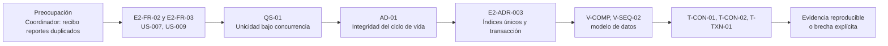

*Figura F20. Un recorrido completo. Debe poder leerse en sentido inverso.*

## 12.2 Matriz de requisitos

El campo de pruebas describe verificación **planificada**, no cobertura ejecutada.

| Requisito | Reglas / fuente | Drivers y decisiones | Vistas y elementos | Pruebas planificadas |
|---|---|---|---|---|
| E2-FR-01 Solicitud con ubicación validada | BR-01/10; US-001/002/003/023 | AD-05, AD-06; ADR-006/008 | V-CTX, V-COMP, V-SEQ-01; módulo Solicitudes | T-FUN-01, T-CONTRACT-01, T-SEC-01 |
| E2-FR-02 Triaje y clasificación | BR-04/12; CL-003/005/007 | AD-01, AD-03; ADR-001/005/007 | Figuras F09 y F13; Triaje y Políticas | T-FUN-01/04, T-POL-01/02, T-SEC-02 |
| E2-FR-03 Creación atómica de la orden | BR-02/03/08 | AD-01, AD-02; ADR-003/007 | V-SEQ-01/02, F07; `TriageApplicationService` | T-CON-01/02, T-TXN-01, T-API-01/02/03 |
| E2-FR-04 Asignación y escalamiento | BR-11; CL-004; ASM-010 | AD-03, AD-07; ADR-005/007 | Asignación; tabla de transiciones | T-FUN-02, T-AUD-01, T-SLA-01 |
| E2-FR-05 Ejecución y bloqueos | BR-06; CL-009 | AD-02; ADR-007 | F10, V-SEQ-03; Órdenes de Trabajo | T-FUN-02, T-INT-01 |
| E2-FR-06 Confirmación, reapertura, cierre | BR-07; CL-006 | AD-01, AD-05; ADR-006/007 | F10; autorización por relación | T-FUN-03, T-SEC-01 |
| E2-FR-07 Atrasos y alertas | SC-06; E2-AS-04 | AD-07; ADR-004/005 | V-SEQ-04; C-WORKER | T-SLA-01 |
| E2-FR-08 Notificaciones | BR-09; ASM-006 | AD-04; ADR-004 | V-SEQ-03; outbox y worker | T-INT-01/02, T-REC-01 |
| E2-FR-09 Auditoría | BR-08; US-019 | AD-02; ADR-007 | F08; `AuditEvent` | T-AUD-01, T-TXN-01 |
| E2-FR-10 Tablero, búsqueda, reportes | CL-011; US-020/021 | AD-05, AD-07 | V-COMP, §8.1; Consultas | T-FUN-05, T-PERF-01 |
| E2-FR-11 Identidad y acceso | BR-10/13; US-022 | AD-05; ADR-006/008 | §9.1–9.4 | T-SEC-01–06 |

## 12.3 Matriz de escenarios de calidad

| Escenario | Driver y decisiones | Mecanismo / vista | Verificación y límite |
|---|---|---|---|
| QS-01 Unicidad | AD-01; ADR-003 | Índices únicos, transacción; V-SEQ-02 | T-CON-01/02; escritor único (E2-AS-06) |
| QS-02 Notificaciones | AD-04; ADR-004 | Outbox, lease, reintentos; V-SEQ-03 | T-INT-01/02; caída acotada, no disponibilidad ilimitada |
| QS-03 Auditoría | AD-02; ADR-007 | Auditoría atómica; F08 | T-AUD-01, T-TXN-01; no resiste a un superusuario |
| QS-04 Seguridad | AD-05; ADR-006 | Autorización por recurso; §9.1 | T-SEC-01–06; no es prueba de penetración |
| QS-05 Políticas | AD-03; ADR-005 | Política versionada | T-POL-01/02; sin recarga en caliente |
| QS-06 Atrasos | AD-07; ADR-004/005 | Scheduler del worker; V-SEQ-04 | T-SLA-01 |
| QS-07 Pico | AD-06, AD-07 | Consultas acotadas y paginadas | T-PERF-01; solo entorno declarado |
| QS-08 Seguridad operativa | AD-02, AD-03 | Atomicidad triaje + evento | T-SAF-01; regla provisional |
| QS-09 Interoperabilidad | AD-04; ADR-008 | Proyección y validación de esquema | T-CONTRACT-01; simulaciones, no proveedor real |

## 12.4 Trazas inversas de ejemplo

**Desde `C-WORKER`.** Existe porque las notificaciones no deben bloquear ni revertir las órdenes (BR-09, QS-02) y porque los atrasos deben detectarse sin intervención humana (QS-06). ADR-004 selecciona la entrega durable. El worker reclama filas de `C-DB`, usa adaptadores documentados y registra resultados, sin decidir la validez de órdenes. Aparece en las vistas de contenedores, secuencia y despliegue. T-INT-01/02, T-SLA-01 y T-REC-01 prueban sus afirmaciones. Un worker sin tabla de entregas, contrato con el receptor ni prueba de recuperación tendría una traza rota.

**Desde el índice único parcial.** Existe porque dos solicitudes distintas pueden convertirse en dos órdenes casi simultáneas para el mismo problema. No es un mecanismo de autorización, ni evalúa políticas, ni protege contra órdenes creadas por otro sistema. Se valida con conexiones independientes contra la base real, no con un repositorio simulado.

## 12.5 Glosario técnico

| Término | Significado en este documento |
|---|---|
| Driver de arquitectura | Requisito, escenario o restricción significativo con una consecuencia de diseño |
| ADR | Registro de una decisión consecuente con su contexto, alternativas y consecuencias |
| Vista | Representación seleccionada para responder la pregunta de un stakeholder |
| Contenedor (C4) | Aplicación o almacén de datos en ejecución; no es necesariamente un contenedor Docker |
| Monolito modular | Una aplicación desplegada en conjunto con fronteras internas explícitas |
| Invariante | Propiedad que debe cumplirse en todos los estados confirmados permitidos |
| Unit of Work | Agrupación de operaciones que se confirman o revierten juntas |
| Outbox transaccional | Intención de integración persistida con el estado de negocio y despachada después |
| Lease | Reclamo de trabajo con duración limitada y token, para que un worker obsoleto no confirme trabajo ajeno |
| Al menos una vez | La entrega puede repetirse; evitar efectos duplicados requiere un receptor compatible |
| Proyección | Representación derivada de datos externos (p. ej. el directorio de espacios) |
| Dead letter | Entrega fallida retenida para diagnóstico tras agotar reintentos |
| Trazabilidad | Vínculos navegables entre requisitos, decisiones, diseño y verificación |
| Evidencia | Observación reproducible de una ejecución real; no un resultado esperado ni un diagrama |

## 12.6 Referencias

**Del curso:** guía del curso de Software Design II, sección de la Evaluación 2; caso DH-00 (ejemplo guiado); RFP DH-02; Perfil institucional común de Digital Horizon; artefactos de la Evaluación 1 de este proyecto.

**Técnicas:** C4 model (c4model.com); arc42 (arc42.org); M. Nygard, *Documenting Architecture Decisions*; OpenID Connect Core 1.0; documentación de PostgreSQL (índices únicos parciales, bloqueo explícito, tipos de rango); patrón Transactional Outbox; OWASP Authorization y Session Management Cheat Sheets; RFC 9110 (semántica HTTP); RFC 9457 (problem details); documentación de Mermaid.

