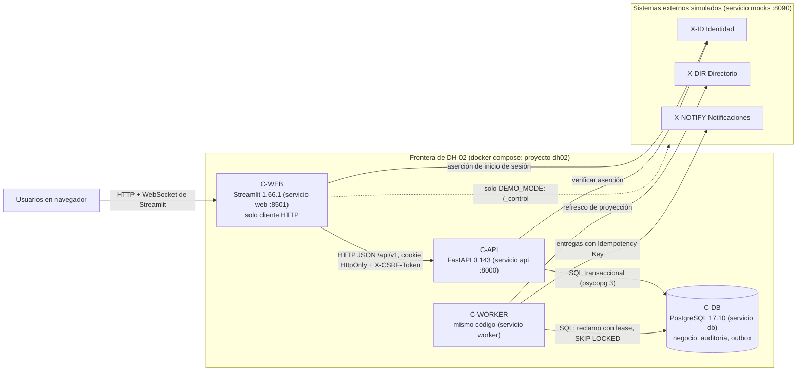
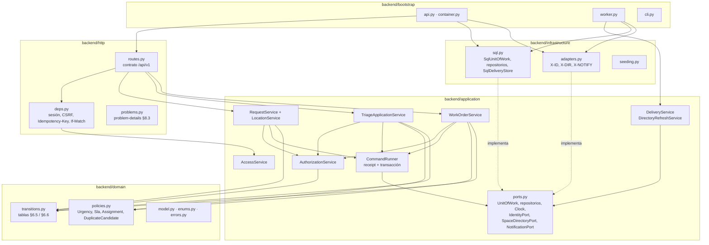
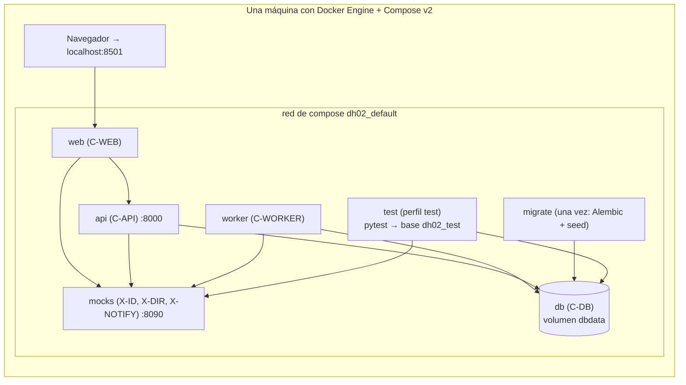

# Vistas actualizadas — lo que realmente existe (Evaluación 3)

Solo se redibujan las vistas que cambiaron o que describen el código implementado. Los nombres son los mismos
de la Evaluación 2 (`C-WEB`, `C-API`, `C-WORKER`, `C-DB`, `X-ID`, `X-DIR`, `X-NOTIFY`). V-CTX (§5.1) no cambió.

## V-CONT — Contenedores (actualiza §5.2, Figura F02)



*Cambios respecto de F02: C-WEB es Streamlit (E2-ADR-009) y obtiene la aserción de X-ID en lugar del navegador.
C-API no llama a X-DIR en línea: valida contra la proyección local que mantiene C-WORKER. No hay proxy Nginx
ni TLS (D-10). La flecha punteada existe solo en el entorno de demostración.*

## V-COMP — Componentes del backend implementados (actualiza §5.3, Figura F03)



*Las flechas son importaciones reales. import-linter verifica que `domain` no importe a nadie fuera de sí mismo,
que `application` no importe `infrastructure`, `http`, SQLAlchemy ni HTTPX, y que `http` e `infrastructure` no se
importen entre sí (T-ARCH-01).*

## V-SEQ-01/02 implementado — Triaje que crea la orden y su error principal

```mermaid
sequenceDiagram
    actor C as Coordinador (coord-03)
    participant W as C-WEB (Streamlit)
    participant A as C-API
    participant DB as C-DB
    C->>W: Aprobar SR-2043 (ELECTRICAL, HIGH)
    W->>A: POST /api/v1/requests/SR-2043/triage<br/>Cookie, X-CSRF-Token, If-Match "request-SR-2043-v3", Idempotency-Key
    A->>A: deps.py: sesión → Principal (roles desde ROLE_ASSIGNMENT); CSRF; ETag → versión 3
    A->>DB: BEGIN · pg_advisory_xact_lock(clave) · SELECT command_receipt
    A->>DB: SELECT … FROM maintenance_request FOR UPDATE
    A->>A: AuthorizationService + plan_transition("approve"): actor → estado → motivo
    A->>DB: UPDATE solicitud (APPROVED, v4) · INSERT triage_record
    A->>DB: SAVEPOINT · INSERT work_order (CREATED)
    alt índice uq_work_order_active_slot libre
        A->>DB: INSERT audit_event ×2 · INSERT outbox_event · INSERT command_receipt
        A->>DB: COMMIT
        A-->>W: 201 · ETag "work-order-WO-3001-v1" · Location
    else otra transacción ya tiene una orden activa en (ubicación, categoría, discriminador)
        DB-->>A: espera hasta que la otra confirme → unique_violation
        A->>DB: ROLLBACK TO SAVEPOINT · SELECT orden ganadora
        A->>DB: ROLLBACK (sin auditoría, outbox ni receipt)
        A-->>W: 409 DUPLICATE_CANDIDATE_EXISTS · existingWorkOrderId
    end
    W-->>C: mensaje legible + pie con "POST …/triage → 201|409"
```

*Diferencias con F13/F14: el receipt se busca **antes** de la precondición (§8.4) bajo un bloqueo por clave;
la traducción del error usa un SAVEPOINT para leer la orden ganadora en la misma transacción; la notificación
nunca se envía dentro de la transacción: la entrega la hace C-WORKER.*

## V-DEP — Despliegue real de la demostración (actualiza §5.5)



*Un solo dominio de falla (R-011). Los servicios tienen health checks y `api`/`worker` esperan a que `migrate`
termine con éxito.*
